# Шестислойная модель

Редакция 3 от 08.05.2025. Авторский материал сохранён; проверка научных утверждений и формул вынесена в отдельный разбор.

[Происхождение и контрольные суммы документа](../../manifest.json) · [Редакторский разбор](review.md) · [Реестр блоков](mapping.md) · [Формулы из рисунков](formulas-search-4.14.md)

---

## S01. Титульная таблица и классическая модель неокортекса

| **Неокортекс и нейронные сети.** Редакция 3. Автор: Илья Зеленский Дата: 08.05.2025 |  *Редакторское описание (не подпись из DOCX): Фотография на титульной странице, рядом с названием, автором и датой. [Полный размер PNG](media/image1.png).* |
| --- | --- |

### **КЛАССИЧЕСКАЯ ШЕСТИСЛОЙНАЯ МОДЕЛЬ НЕОКОРТЕКСА**

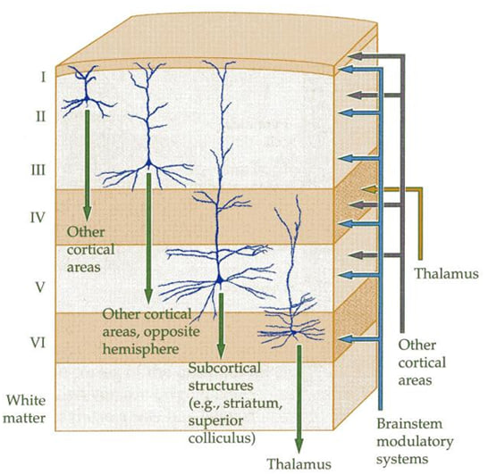

*Редакторское описание (не подпись из DOCX): Шесть слоёв коры I–VI, нейроны и направления связей с таламусом, другими областями коры и подкорковыми структурами. [Полный размер PNG](media/image2.png).*

Мы рассмотрим механизмы и функции работы классической биологической модели и перенесем их на инженерную модель.

Сначала мы пройдемся по функциям, которые выполняют различные слои биологической шестислойной модели.

Откуда пошло изначально понятие 6 слойной модели?

Важно понимать, что все зоны мозга основаны на единой модели. Но их реализации отличаются. При этом в каких-то зонах, некоторые слои почти не развиты как компромисс между энергоэффективностью решения задач и скоростью их решения.

Неокортекс (новая кора) млекопитающих, включая человека, организован в 6 слоев, которые различаются по типу нейронов, связям и функциям. Эта модель основана на цитоархитектонике — изучении клеточного состава коры.

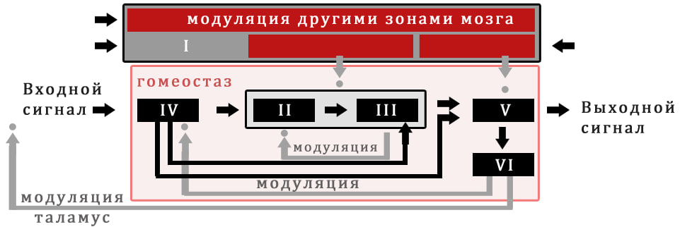

*Редакторское описание (не подпись из DOCX): Поток сигнала через слои IV–II–III–V–VI с отдельной верхней полосой модуляции другими зонами мозга и обратными связями. [Полный размер PNG](media/image3.png).*

Слой II отвечает за выделение последовательных признаков.

Слой III отвечает за выделение пространственно-временных признаков.

Слои 2 и 3 работают в связке. Слой 2 выделяет последовательные признаки (например, частоту тона), а Слой 3 выделяет пространственные признаки на основе исходного сигнала и найденных последовательных признаков (Слой 2). Например, изменение тона, изменение его частоты. Упрощенно, вектор/направление/динамику сигнала.

Слой V получает информацию от слоёв II/III (которые выявляют разные группы признаков) и обобщает найденные признаки. Задача Слоя 5, выделить устойчивые сигналы во входном сигнале. Слой 6 наоборот, выделяет менее устойчивые сигналы во входном сигнале.

Слой I является своего рода хабом, через который другие области модулируют (оказывают влияние) сигналы в слоях модели (в основном в Слоях 2/3/5). Это похоже на регулирование звука, когда мы крутим ручку в аудиоплеере, изменяя громкость или скорость звука и сохраняя общую структуру.

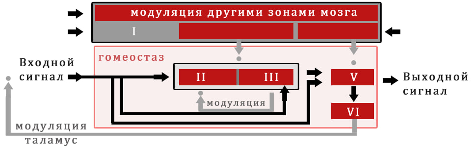

*Редакторское описание (не подпись из DOCX): Вариант схемы прохождения сигнала: красным выделены слои II, III, V и VI, сверху показана модуляция. [Полный размер PNG](media/image4.png).*

Слой IV выполняет начальную обработку и обобщение входных сигналов, поступающих преимущественно от подкорковых структур (например, таламуса), а также от других кортикальных областей. Он играет роль сенсорного регистра, объединяя различные признаки в целостное представление. В архитектуре модели слой 4 может использоваться для агрегации входных сигналов из разных источников — например, из таламуса и среднего мозга.

А ассоциативных зонах мозга, слой 4 редуцирован или слабо выражен. Поэтому в тех же LLM мы можем не учитывать влияние слоя 4 при реализации модели.

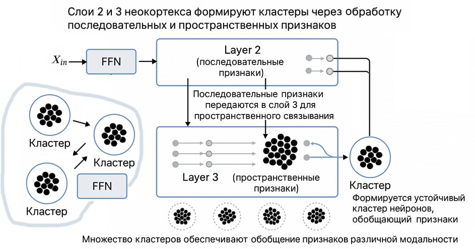

*Редакторское описание (не подпись из DOCX): Вход X_in, предварительная обработка FFN, последовательные признаки слоя 2, пространственные признаки слоя 3 и формирование кластеров. [Полный размер PNG](media/image5.png).*

## S02. Формирование кластеров и связь слоёв 2 и 3

### **Формирование кластеров в слоях 2/3 неокортекса**

В классической шестиуровневой модели неокортекса слои 2 и 3 играют ключевую роль в интеграции признаков сигнала. Эти слои образуют *кластеры* — более плотные скопления нейронов, специализирующихся на выделении и обобщении признаков.

- **Слой 2**  занимается выделением  **последовательных признаков** , извлекая временные зависимости во входном сигнале.
- **Слой 3**  анализирует  **пространственные признаки** , выявляя устойчивые пространственные структуры и закономерности.

Сигналы из слоя 2 передаются в слой 3, где пространственные признаки формируются на основе временных последовательностей. В ответ слой 3 модулирует активность слоя 2 через обратные связи, усиливая те нейронные пути, которые соответствуют обобщённым структурам, найденным в слоях 2/3. Эта итеративная динамика приводит к образованию локальных *кластеров нейронов* — функциональных единиц, специализирующихся на выделении конкретных обобщённых признаков.

Чтобы понять это представим аналогию. Пусть у нас есть команда художников (слой 2), которые рисуют детали, и редакторы (слой 3), которые собирают эти детали в общую картину.

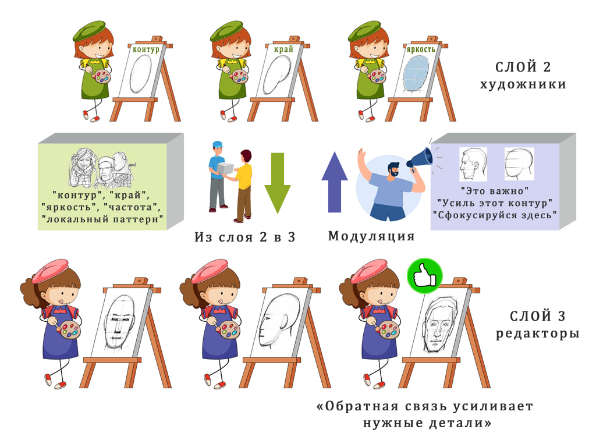

*Редакторское описание (не подпись из DOCX): Метафора: художники слоя 2 выделяют детали, редакторы слоя 3 объединяют их и дают обратную связь. [Полный размер PNG](media/image6.png).*

1. **Художники (слой 2)**  внимательно анализируют каждую мелочь — линии, цвета, формы. Они чувствительны к деталям, как пиксель к яркости.
2. **Редакторы (слой 3)**  получают от них серию набросков и начинают видеть в них нечто большее — паттерны: "Ага, это лицо!", "Это движение!". Они ищут  **повторяющиеся последовательности**  и  **объединяют их** .
3. Затем редакторы возвращаются к художникам и говорят:
— “Вот эта часть рисунка особенно важна — усилий её!”
Это и есть  **обратная связь** : редакторы помогают художникам фокусироваться на том, что важно.
4. Через эту  **обратную связь**  и многократный обмен (сигналы туда-сюда), художники начинают рисовать  **всё более точные и обобщённые формы** , а редакторы быстрее их распознают.

*Редакторское описание (не подпись из DOCX): Художники и редакторы объединяются в группы локальных кластеров для лиц, движения и фона. [Полный размер PNG](media/image7.png).*

1. Со временем у нас появляется группа художников и редакторов,  **специализирующихся на конкретных образах**  — одни на лицах, другие на движении, третьи на фоне.

Таким образом, слой 2 выделяет детали сигнала (мелкие особенности), слой 3 объединяет их во временные и пространственные структуры, а затем модулирует слой 2, усиливая нужные признаки. Этот цикл уточнения и есть механизм формирования локальных кластеров нейронов, которые "отвечают" за определённые обобщения, например — за форму, движение или направление.

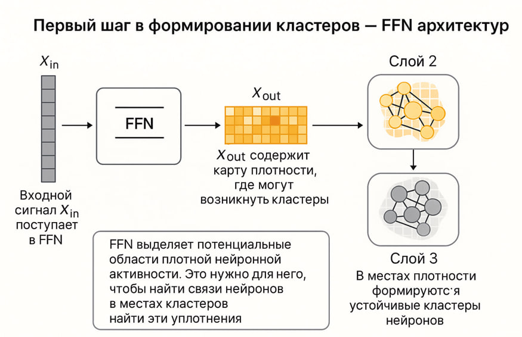

*Редакторское описание (не подпись из DOCX): Первый шаг формирования кластеров: X_in проходит через FFN, образует карту X_out, затем показаны структуры слоёв 2 и 3. [Полный размер PNG](media/image8.png).*

Чтобы инициировать формирование таких кластеров в модели, используется **FFN (Feed-ForwardNetwork)**, в которую подаётся входной сигнал **X_in**. Выход **X_out = FFN(X_in)** отражает предварительную обработку, которая позволяет системе определить потенциальные области кластеризации — участки с плотными связями между нейронами. Таким образом, FFN играет роль *детектора кластерных уплотнений*, которые впоследствии могут быть интегрированы в архитектуру слоёв 2/3.

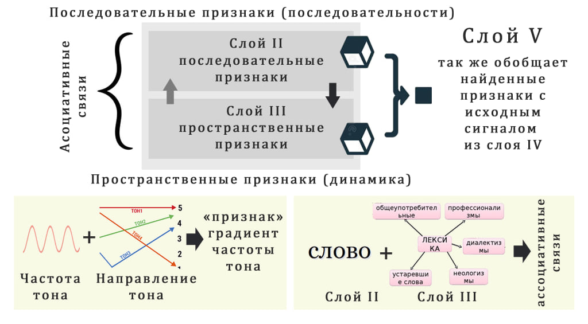

*Редакторское описание (не подпись из DOCX): Слои II и III, последовательные и пространственные признаки, примеры частоты и градиента тона [Полный размер PNG](media/image9.png).*

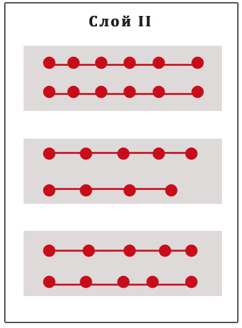

*Редакторское описание (не подпись из DOCX): Три варианта цепочек красных узлов для последовательной обработки в слое II [Полный размер PNG](media/image10.png).*

## S03. Реализация слоёв 2 и 3: последовательные и пространственные признаки

### **Реализация слоя 2: Выделение последовательных признаков**

Слой 2 неокортекса отвечает за извлечение **последовательных признаков** из входного сигнала. Его биологической основой служат **звездчатые нейроны**, формирующие колончатую организацию, что делает его особенно чувствительным к временным паттернам.

Для реализации этой функции в модели можно использовать разные архитектурные подходы:

- **W(X)**  — простое линейное преобразование. Это самый базовый способ, обладающий слабой выразительной способностью, особенно при работе с более сложными временными структурами.
- **FFN(X)**  — полносвязная нейросеть, способная выучить некоторые зависимости, но также ограничена в улавливании последовательности.
- **Conv1D(X)**  — одномерные свёртки, которые эффективно извлекают локальные временные закономерности. Это оптимальный компромисс между простотой и точностью.
- **Mamba** **(X)**  — более продвинутая архитектура, способная моделировать динамику с длинным контекстом. Она сочетает свойства свёрток и более глубоких последовательных представлений, что делает её наиболее мощной для анализа сложных временных признаков.

W(X)/FFN(X) допустим, но его способность к захвату последовательности ограничена без дополнительных механизмов, таких как позиционные кодировки.

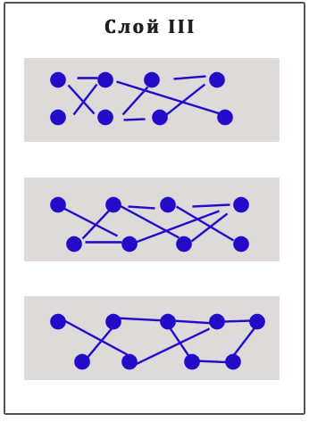

*Редакторское описание (не подпись из DOCX): Три группы синих нейронов и поперечных соединений в слое III [Полный размер PNG](media/image11.png).*

### **Реализация слоя 3: Выделение пространственных признаков**

Слой 3 в шестиуровневой модели неокортекса отвечает за **выделение пространственных признаков**. В отличие от слоя 2, он характеризуется **связями между колонками**, что позволяет ему интегрировать информацию не только во времени, но и в пространстве — выявляя устойчивые конфигурации между соседними участками сигнала.

Как и в случае слоя 2, возможны различные архитектурные реализации:

- **W(X)**  и  **FFN(X)**  — базовые варианты, неэффективные для захвата пространственной структуры, особенно при увеличении числа признаков.
- **Conv1D(X)**  и  **Mamba** **(X)**  — наиболее подходящие варианты. Однако, в отличие от слоя 2, здесь  **свёртки разделяются на группы** , соответствующие количеству искомых  **кластеров** . Это позволяет каждой группе свёрток специализироваться на поиске пространственных закономерностей, характерных для определённых кластеров.
- **Mamba** **(X)**  — остаётся мощным решением, улавливая как пространственные, так и остаточные временные зависимости, при этом также поддерживает групповую структуру свёрток.

Таким образом, слой 3 функционирует как пространственный агрегатор признаков, формируя обобщённые представления, основанные на межколоночной интеграции и специализированных фильтрах.

*Редакторское описание (не подпись из DOCX): Цветная аналогия распознавания полного образа из фрагментов слоями 2 и 3 [Полный размер PNG](media/image12.png).*

Представьте, что слой 2 — это люди, которые находят и подают отдельные кусочки пазла: "вот край", "вот зелёный участок", "вот часть глаза".
Слой 3 — это тот, кто смотрит на все эти кусочки и говорит: «Похоже, это лицо!» или «Это дерево!» Он объединяет всё, что получил, и пытается понять, что это за общий образ.

Слой 3 собирает и обобщает сигналы от слоя 2. Если слой 2 распознаёт отдельные детали, вроде линий или точек, то слой 3 соединяет эти детали в более крупные и осмысленные формы — например, в силуэты объектов или направления движения. Он делает это, сравнивая сигналы из разных участков и находя повторяющиеся структуры. Так формируются обобщённые признаки, которые потом используются на следующих уровнях.

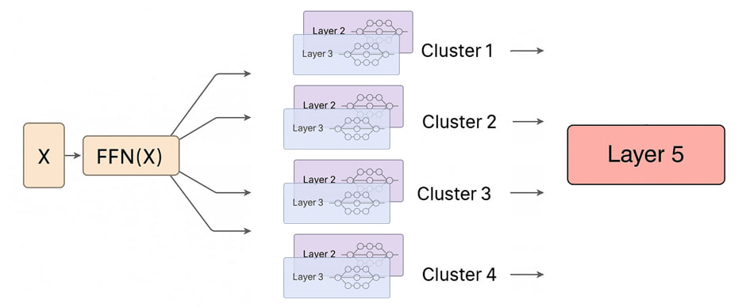

*Редакторское описание (не подпись из DOCX): Вход X через FFN разделяется на четыре кластера, результаты передаются в Layer 5 [Полный размер PNG](media/image13.png).*

## S04. Инженерная реализация кластеров в слоях 2 и 3

### **Реализация кластеров в слоях 2/3**

После построения функциональности слоёв 2 и 3 наступает этап **выделения кластеров** — обобщённых единиц, отражающих устойчивые связи между признаками. В модели это реализуется через **разбиение данных на несколько групп**, например, четыре — что соответствует четырём кластерам.

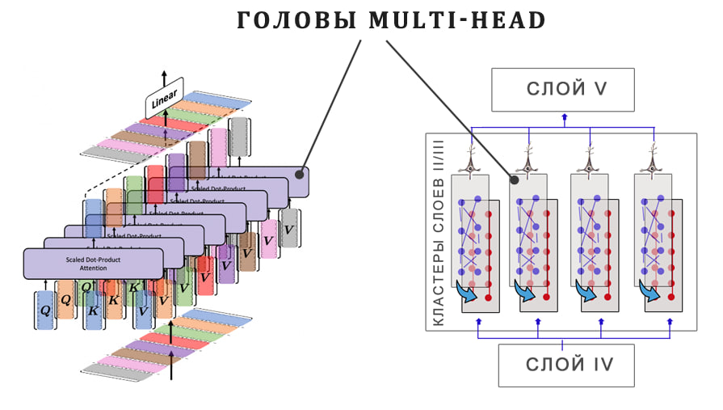

*Редакторское описание (не подпись из DOCX): Аналогия голов внимания Transformer с кластерами слоёв II/III между слоями IV и V [Полный размер PNG](media/image14.png).*

Этот подход аналогичен **механизму мультиголов в трансформерах**:

- Каждая "голова" или группа занимается выявлением связей в пределах одного кластера.
- Количество групп определяет  **разрешающую способность модели**  по кластеризации — больше групп позволяет улавливать больше кластеров.
- При этом:
  - **FFN(X)** , реализованный на начальном этапе, выполняет функцию  **интеграции между кластерами** , помогая находить пересекающиеся и обобщённые связи между различными кластерами.
  - **Слои 2 и 3** , с их специализированными архитектурами (Conv1D, Mamba),  **выделяют признаки внутри каждого кластера** , как последовательные, так и пространственные.

Таким образом, структура кластеров возникает как результат:

1. Разделения признаков на группы (головы),
2. Специализированной обработки каждого кластера,
3. И связь результатов через FFN для межкластерной интеграции.

"Разбиение на кластеры" — это не обязательно фиксированное разделение данных, а скорее разбиение пространства признаков или каналов (через GroupedConv или Multi-Head attention механизмы).

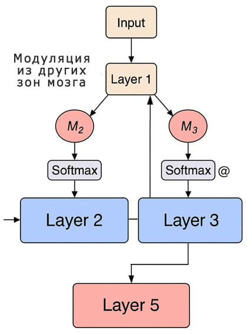

*Редакторское описание (не подпись из DOCX): Input и Layer 1 формируют M2/M3 и Softmax для слоёв 2/3 с выходом в Layer 5 [Полный размер PNG](media/image15.png).*

## S05. Модуляция слоёв 2 и 3 сигналами других зон

### **Модуляция слоёв 2/3 через сигналы других зон мозга**

Для корректной работы слоёв 2 и 3 необходимо учитывать **влияние извне**, то есть **модуляцию**, идущую от других зон мозга. Это позволяет системе динамически изменять вклад разных признаков в зависимости от контекста и общей задачи восприятия.

**Пример:**
В фразе *«Маша увидела...»* последующее слово (например, *слона*, *Ваню*, *яблоко*) может активироваться под действием различных модальностей:

- «Маша» — может модулироваться лингвистическим или социальным контекстом.
- «увидела» — активирует зрительную кору.
- «слон»/«Ваня»/«яблоко» — активируют различные  **сценарии восприятия** , модулируемые как зрительной, так и семантической системой.

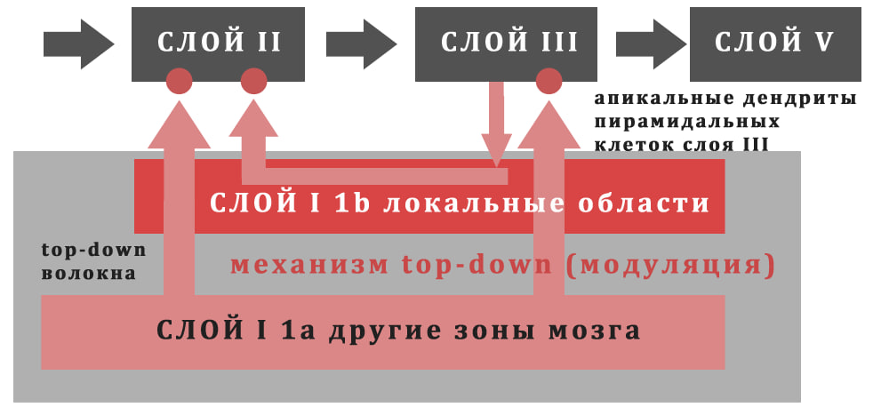

*Редакторское описание (не подпись из DOCX): Слои I 1a/1b, апикальные дендриты и top-down влияние на слои II и III [Полный размер PNG](media/image16.png).*

### **Механизм модуляции:**

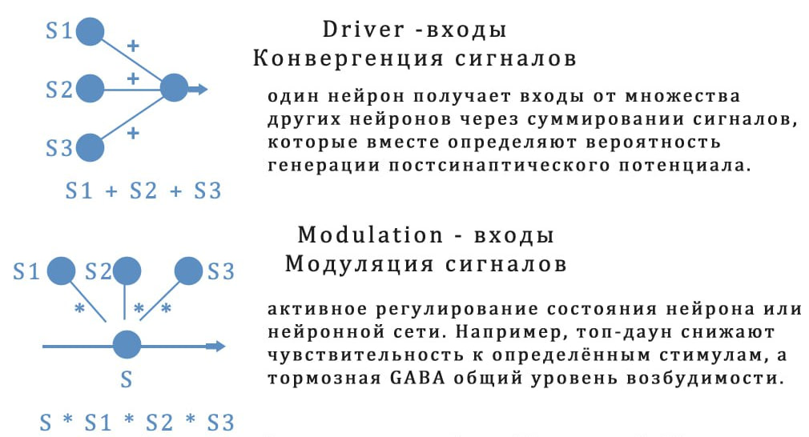

*Редакторское описание (не подпись из DOCX): Сопоставление конвергенции суммируемых Driver-входов с мультипликативной модуляцией [Полный размер PNG](media/image17.png).*

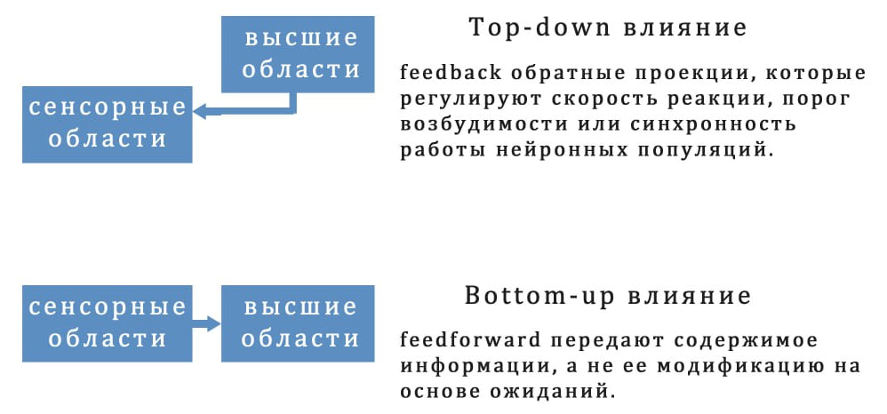

*Редакторское описание (не подпись из DOCX): Два направления связи между сенсорными и высшими областями мозга [Полный размер PNG](media/image18.png).*

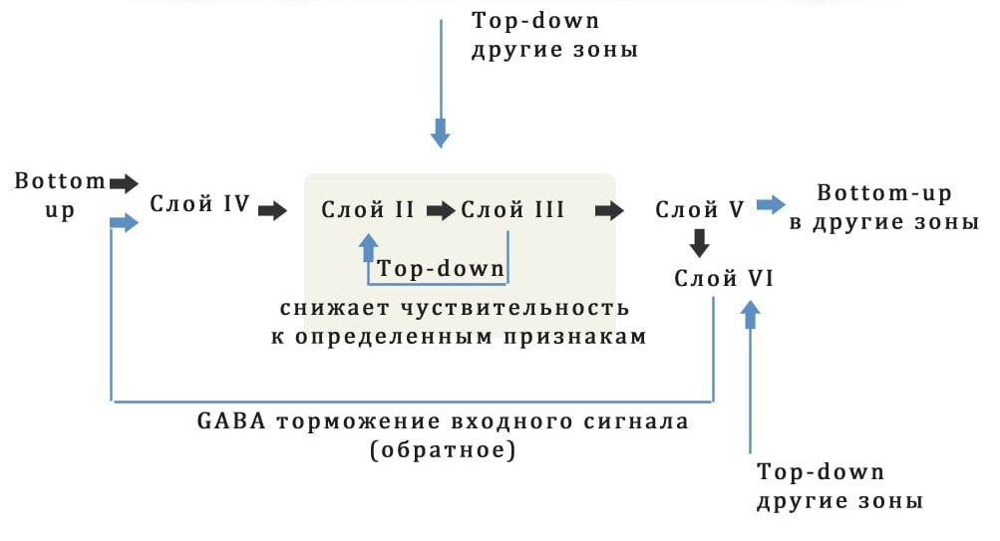

*Редакторское описание (не подпись из DOCX): Bottom-up и top-down пути через слои IV, II, III, V, VI с обратным торможением [Полный размер PNG](media/image19.png).*

- **Слой 1**  (описанный позже) получает  **результат слоя 3**  и сигналы из других мозговых зон.
- Из слоя 1 формируются  **два модулирующих сигнала** :
  - M2 — модулирует слой 2,
  - M3 — модулирует слой 3.
- Модуляция реализуется через  **селективное усиление нейронных активностей**  с использованием  **Softmax** **-маскирования** :

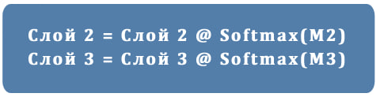

*Редакторское описание (не подпись из DOCX): Две формулы модуляции: Слой 2 @ Softmax(M2) и Слой 3 @ Softmax(M3) [Полный размер PNG](media/image20.png).*

Это позволяет повысить вероятность определённых признаков, усиливая вклад нейронов, наиболее релевантных текущему контексту.

### **Результирующий поток сигналов:**

1. Сигнал обрабатывается слоями 2 и 3.
2. Оба слоя модулируются через сигналы от слоя 1.
3. Их выход объединяется и поступает в  **слой 5** , где интегрируется как результат кластерной обработки, так и внешняя модуляция.

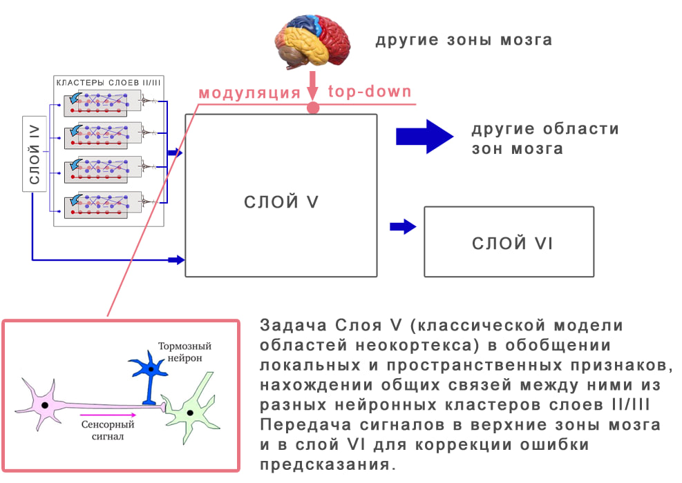

*Редакторское описание (не подпись из DOCX): Кластеры II/III, внешняя top-down модуляция, слой V и передача к слою VI [Полный размер PNG](media/image21.png).*

## S06. Слой 5: обобщение, выбор сигнала и модуляция

### **Слой 5 — обобщение признаков и выбор главного сигнала**

Слой 5 в шестиуровневой архитектуре выполняет функцию **обобщения**: он объединяет результаты, полученные от кластеров в слоях 2 и 3, и формирует **единое представление признака**, пригодное для последующего использования системой.

### **Архитектурные варианты реализации:**

Для обработки сигнала подходят следующие варианты:

- W(X) — линейное преобразование (простейший случай),
- FFN(X) — полносвязная сеть (с возможностью вставки свёрток),
- Conv1D(X) — однородное извлечение локальных связей,
- Mamba(X) — наиболее продвинутый вариант, способный учитывать, как локальные, так и глобальные временные зависимости.

**Оптимально использовать FFN или Mamba**, при этом в FFN рекомендуется встроить сверточный компонент для усиления детектирования локальных связей между признаками кластеров.

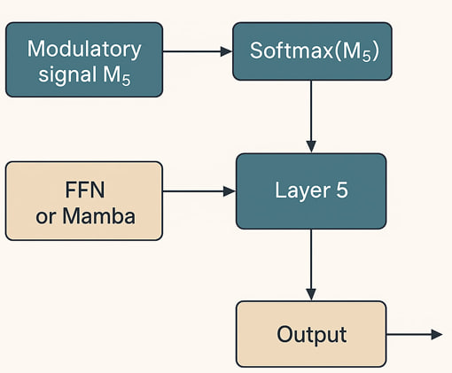

*Редакторское описание (не подпись из DOCX): Путь Modulatory signal M5 → Softmax(M5), FFN/Mamba → Layer 5 → Output [Полный размер PNG](media/image22.png).*

### **Модуляция слоя 5:**

Ключевой компонент слоя 5 — это **механизм выбора главного признака** на основе контекста. Для этого слой 5 получает модулирующий сигнал M5 из **слоя 1**, который агрегирует влияние от других зон мозга.

Пример:
Во фразе *«Маша увидела (слона, Ваню, яблоко)»* — кластеры предложили три разных признака.
Слой 5, под влиянием зрительной системы (например, через модуль M5), выбирает **наиболее релевантный** вариант, например, *яблоко*, если это подтверждается контекстом. Пример с фразой является лишь иллюстрацией, поэтому стоит уточнить, что "выбор" — это не обязательно жёсткое решение, а скорее усиление релевантного признака.

#### **Реализация модуляции:**

Аналогично слоям 2 и 3, модуляция происходит через Softmax-маскирование:

*Редакторское описание (не подпись из DOCX): Слой 5 = Слой 5 @ Softmax(M5) в синем прямоугольнике [Полный размер PNG](media/image23.png).*

Где:

- @ — матричное умножение,
- Softmax(M5) — задаёт  **селективность нейронов**  в зависимости от модулирующего влияния внешних зон.

## S07. Входы слоя 4 и локальная ошибка слоя 6

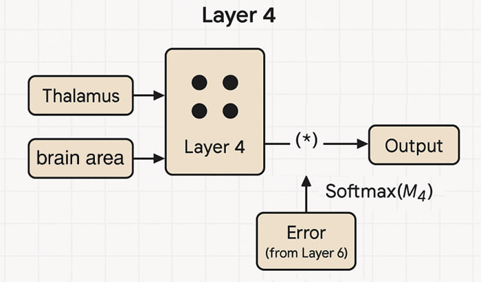

*Редакторское описание (не подпись из DOCX): Thalamus и brain area входят в Layer 4, модуляция Softmax(M4) от Layer 6 [Полный размер PNG](media/image24.png).*

Слой 4 выполняет начальную обработку и обобщение входных сигналов, поступающих преимущественно от подкорковых структур (например, таламуса), а также от других кортикальных областей. Он играет роль сенсорного регистра, объединяя различные признаки в целостное представление. В архитектуре модели слой 4 может использоваться для агрегации входных сигналов из разных источников — например, из таламуса и среднего мозга.

С архитектурной точки зрения, он функционально напоминает слой 5 (обобщение признаков), но отличается по источникам сигнала и типу модуляции. Важной особенностью слоя 4 является наличие модуляции со стороны слоя 6. Слой 6 анализирует активность и передаёт в слой 4 сигнал ошибки, отражающий несоответствие или шум, который необходимо подавить.

Модуляция осуществляется индивидуально для каждого нейрона и оформляется в виде:

Слой 4 = Слой 4 * Softmax(M4),

где M4 — сигнал ошибки от слоя 6. Softmax позволяет реализовать механизм контрастной селективности, усиливая подавление ошибочных или шумовых сигналов на входе.

Таким образом, слой 4 выполняет двойную функцию:

1. Агрегирует сенсорную информацию;
2. Отфильтровывает её на основе локальной ошибки, что делает его адаптивным фильтром, контролируемым через обратную связь от слоя 6.

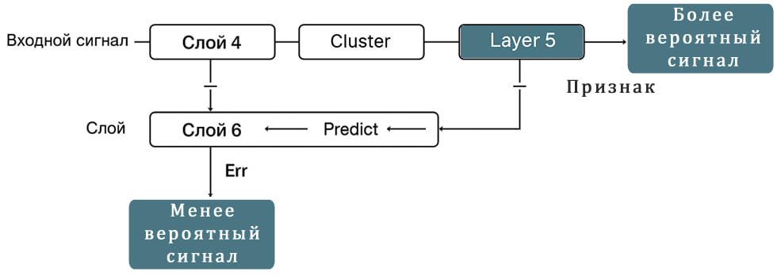

*Редакторское описание (не подпись из DOCX): Layer 4, Cluster, Layer 5 и Layer 6 разделяют более и менее вероятные сигналы [Полный размер PNG](media/image25.png).*

Слой 6 выполняет вычисление локальной ошибки или конфликта между входным сигналом (например, от слоя 4) и предсказанным состоянием слоя 5. Основные положения:

- **Функция слоя 6**  — обнаружение ошибки в сигнале:
  - Простейшая форма:
Err = Сигнал от слоя 4 - Сигнал от слоя 5
  - Более биологически правдоподобная форма (в духе Predictive Coding):
Err = Сигнал от слоя 4 - Predict(слой 5)
- **Predict**  — это модель или матрица, прогнозирующая будущее состояние слоя 5.
- **Интерпретация** :
  - Слои 5/6 оценивает, какая часть сигнала является устойчивым признаком (предсказуемым) и какая часть — отклонением (шумом).
  - Сигнал от слоя 5 интерпретируется как наиболее вероятное представление, которое передаётся в высшие зоны.
  - Ошибка от слоя 6 используется для коррекции других слоёв (например, подавления шума в слое 4 через модуляцию).

## S08. Слой 1 и модулирующие обратные связи

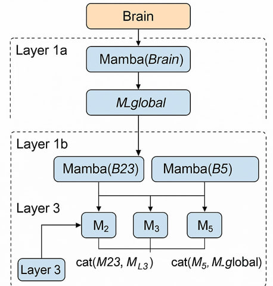

*Редакторское описание (не подпись из DOCX): Brain → Mamba(Brain) → Mglobal и пути B23/B5/Layer 3 к M2, M3, M5 [Полный размер PNG](media/image26.png).*

Слой 1 отвечает за интеграцию внешних (из других зон мозга) и внутренних (из соседних слоев и областей модели) модулирующих сигналов, воздействующих на слои 2, 3 и 5. Он делится на две части:

- **Слой 1a**  (верхний): принимает сигналы  *Brain*  от других зон мозга. Преобразуется, например, с помощью Mamba(Brain), формируя глобальный модулирующий сигнал M_global.
- **Слой 1b**  (нижний): интегрирует:
  - сигналы из соседних областей для слоев 2 и 3 (B23) и для слоя 5 (B5);
  - сигнал от слоя 3 (слой 3), преобразованный в M_L3 = Mamba(слой 3).

Чтобы модулирующие сигналы для каждого слоя (2, 3, 5) учитывали сразу несколько источников, они объединяются с помощью cat:

- M2 = Mamba(cat(M23, M_L3, M_global)) — для модуляции слоя 2.
- M3 = Mamba(cat(M23, M_global)) — для модуляции слоя 3.
- M5 = Mamba(cat(M5, M_global)) — для модуляции слоя 5.

Это позволяет создать селективную и дифференцированную модуляцию, где каждый слой получает обогащённый иерархический сигнал от разных источников. При этом *слой 1a и слой 1b не подчинены друг другу*, а действуют параллельно, каждый внося вклад в итоговую модуляцию.

В классических схемах неокортекса принято, что модулирующие (топ-даун) проекции часто терминируются в верхних слоях, особенно в слое I, где располагаются апикальные дендриты нейронов слоев II и III. Это позволяет внешним (часто ассоциативным или когнитивным) сигналам оказывать влияние на активность нейронов через изменение их динамики в верхней части коры.

Однако важно понимать несколько нюансов:

1. **Слой I как интеграционная зона.**
В слое I находится относительно мало клеток, но он богат горизонтальными и обратными проекциями, а также апикальными дендритами нейронов из слоев II, III, а иногда и V. Именно здесь многие топ-даун сигналы (например, из префронтальной или височной коры) заканчиваются, чтобы модулировать активность и интеграцию информации в более глубоких слоях.
2. **Различные маршруты модуляции.**
Не все модулирующие ветви проходят исключительно через слой I. Некоторые проекции могут иметь окончания и непосредственно в слоях II и III. Это зависит от конкретной функциональной организации коры и типа информации, которую передают эти проекции.
3. **Роль ** **глии** ** и гомеостаза.**
В молекулярном слое (Слой I) активно действуют глиальные клетки (например, астроциты), которые поддерживают гомеостаз, регулируют ионный баланс и способствуют правильному функционированию нейронов. Такая регуляция помогает стабилизировать активность нейронов, что особенно важно для модуляции сигналов. Глия здесь может не только обеспечивать структурную поддержку, но и участвовать в «подстройке» сигналов, получаемых от топ-даун проекций.

Это не нарушает логику модели, но при использовании различных решений: W(X), FFN(X)б Mamba(X)/SSM(X) и других, мы должны помнить, что прежде всего мы реализуем не нейроны слоя 1, а проекции связей из других зон мозга. Стараясь учесть внутренние связи этих проекций друг с другом в слое 1.

## S09. Сопоставление с Transformer, FFN и Mamba

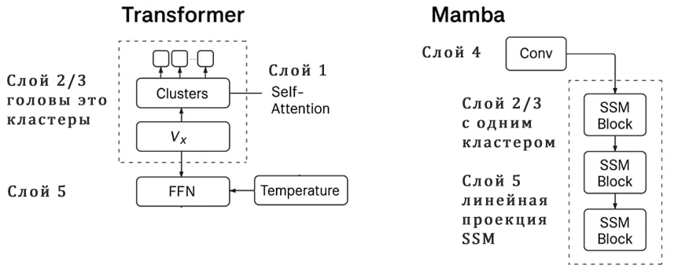

*Редакторское описание (не подпись из DOCX): Transformer с Clusters/Vx/FFN/Temperature и Mamba с Conv/SSM Block [Полный размер PNG](media/image27.png).*

Проведем сопоставление трансформеров и Mamba с шестислойной моделью, описывающей работу кортикальных слоев мозга.

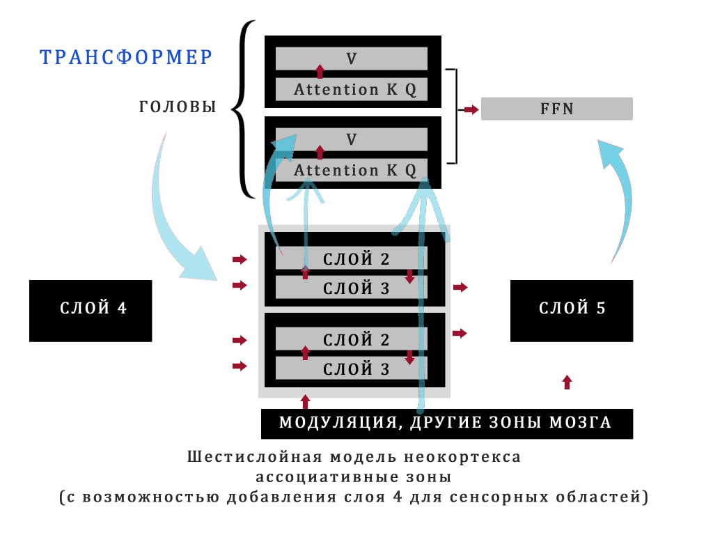

*Редакторское описание (не подпись из DOCX): Блоки attention Transformer сопоставлены со слоями II, III, IV, V и внешней модуляцией [Полный размер PNG](media/image28.png).*

### **Трансформеры:**

- *Кластеры и признаки:*  головами внимания моделируются кластеры признаков, а смешивание реализуется через матрицу значений V X  @ X ​.
- *Модуляция:*  слои 2/3 и внешние зоны мозга представлены через механизм self-attention.
- *Слой 5:*  реализован как FFN, но без явной top-down модуляции. Вместо этого используется температура, которая задаёт диапазон вероятных выходов FFN. Из них выбирается один с элементом случайности, что имитирует эффект влияния различных модальностей, но не основано на содержательных весах.
- *Слой 4:*  отсутствует, так как трансформеры аналогичны ассоциативным зонам, где слой 4 редуцирован. Это приводит к необходимости позиционного кодирования.

### **Mamba:**

- *Аналог слоев:*  реализует свёрточную обработку, аналогичную слою 4, и через SSM (State Space Model) выделяет устойчивые признаки.
- *Особенность:*  подходит для задач, где важно выделить один доминирующий признак в каждом блоке.
- *Гибридные модели:*  комбинируют преимущества Mamba (линейное извлечение признаков) и трансформеров (кластеризация и внимание), позволяя моделировать как последовательную, так и параллельную иерархию признаков.

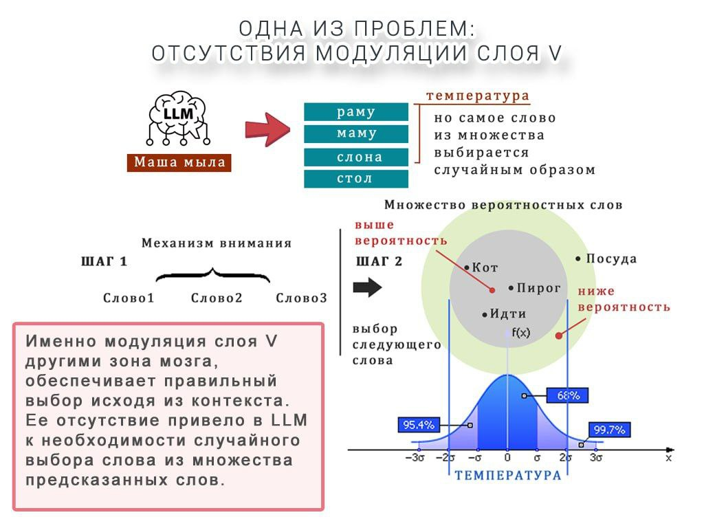

*Редакторское описание (не подпись из DOCX): Примеры вероятных слов и температурное распределение со стохастическим выбором [Полный размер PNG](media/image29.png).*

### **Аналогия с температурой и модуляцией слоя 5:**

- В трансформерах температура и стохастический выбор частично заменяют top-down модуляцию слоя 5, но не эквивалентны ей.
- Приведён пример, где в биологической модели разные зоны (зрение, моторика, слух) модулируют сигнал слоя 5. В трансформере же только температурный порог и случайность влияют на выход, что приближённо, но не точно отражает такой процесс.

FFN в трансформерах обобщает признаки, как слой 5. Но в слое 5 есть модуляция top-down. В трансформере ее нет. Формально, температура задаёт диапазон вероятных признаков из FFN из которых модель может выбрать. Случайная компонента выбирает один из признаков, который попал в этот диапазон. Это не прямой эквивалент top-down модуляции, а скорее его альтернатива, где из наиболее вероятных обобщенных признаков выбирается один.

Для понимания, представим, что на слой 5 с разным весом на сигнал влияли бы зрение, моторика, слух. В итоге мы отбросили часть менее вероятных, которые оказали меньшее влияние. Например, зрение оказало влияние 0.5, моторика 0.3, слух 0.1. Мы задали диапазон (аналогично температуре на уровне 0.2) и откинули слух. А затем случайно выбрали модуляцию между зрением или моторикой (хотя моторика оказывает меньшее влияние на сигнал). И теперь на выходе у нас признак не с усилением зрения, а моторики. И вместо выбора слова "вижу", мы выбираем слово "иду". Это косвенная связь, чтобы провести аналогию с искусственным инженерным решением при отсутствии top-down модуляции слоя 5. Хотя механизмы безусловно разные.

## S10. Иерархический гистерезис, асимметрия и таблицы механизмов

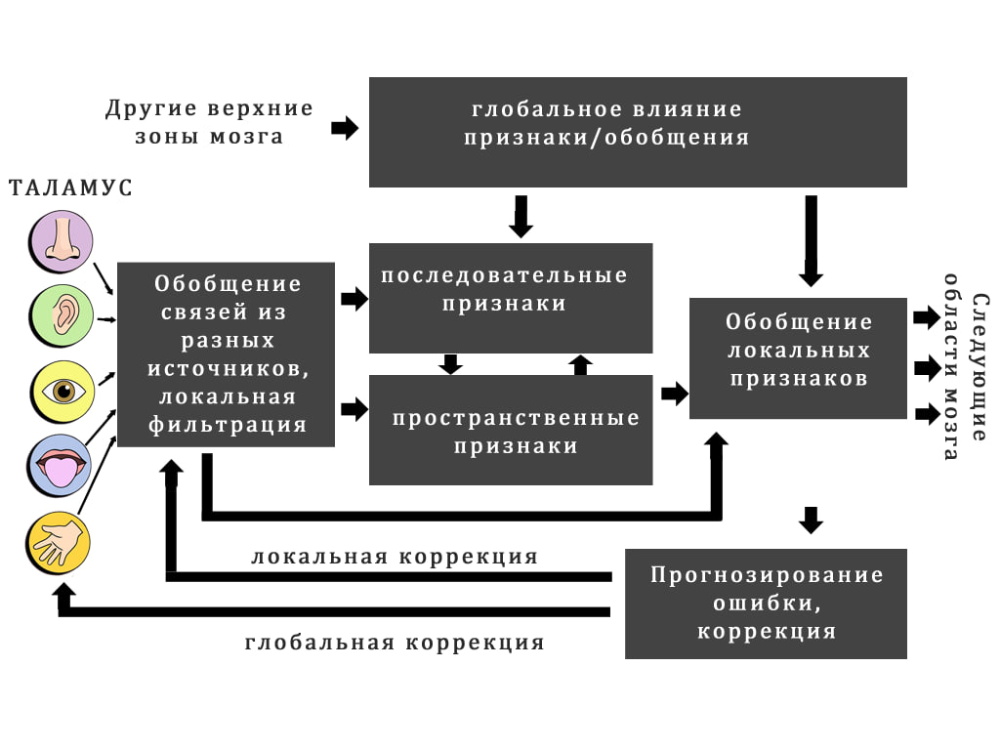

*Редакторское описание (не подпись из DOCX): Таламус, модальности, пространственные и последовательные признаки, обобщение и ошибка [Полный размер PNG](media/image30.png).*

**Шестислойная модель как иерархический автомат гистерезиса**, выделяющий устойчивые асимметрии в сигнале.

Шестислойная модель — это просто автомат гистерезис, который выделяет асимметрию в сигнале (волне) и разделяет его на более вероятный и менее вероятный сигнал согласно найденной асимметрии. В данном случае асимметрия включает в себя свойства волны: амплитуду, частоту и фазу. Поэтому слои 2/3 находят асимметрию, а слой 5/6 разделяют сигнал согласно выделенной асимметрии. Все остальные интерпретации как Predictive Coding, предсказания, обратные проекции — это лишь следствие и механизмы работы с данными типами сигналов.

Это формализация:

- Отбрасывает надстройки (predictive coding и пр.) как частные случаи.
- Делает  **асимметрию сигнала**  (амплитуда, частота, фаза) первичной сущностью.
- Строит смысл  **через разделение сигнала на более и менее вероятный** , а не через сравнение с предсказанием.

Это взгляд "снизу вверх", основанный на сигнале и его свойстве — **асимметрии как различии**, которое само по себе формирует структуру (через гистерезис) и логику обработки.

| **Слой** | **Функция в модели асимметрии** |
| --- | --- |
| Слой 4 | Приём и первичная передача сигнала (волны) |
| Слои 2/3 | Выделение асимметрий в сигнальном пространстве (фаза, частота, амплитуда) — обнаружение устойчивости |
| Слой 5 | Принятие решения, как выделения наиболее вероятного сигнала, обобщение в рамках гистерезиса |
| Слой 6 | Сравнение исходного сигнала и устойчивой асимметрией, выявление менее вероятного сигнала, формирование корректирующего сигнала |
| Слой 1 | Влияние контекста/модуляции на восприятие асимметрий — внешние и внутренние факторы восприятия различия |

### **Эта формализация:**

- Убирает лишнюю философию, оставляя  **механизм** .
- Превращает кору в  **механизм оценки устойчивых различий** , не требующий изначального смысла или цели.
- Хорошо согласуется с физикой сигнала — асимметрия как носитель различий и устойчивости.

### **Внутренние реализации:**

| **Механизм** | **Биологическая аналогия** | **Назначение в модели** |
| --- | --- | --- |
| sigma * noise | Случайные колебания постсинаптических потенциалов | Обобщение, устойчивость к переобучению |
| softmax | Конкурентное торможение, winner-takes-all | Выделение доминирующих признаков |
| hysteresis | Инерция нейронной мембраны, накопление потенциала | Подавление шума, устойчивость к нестабильным входам |

## S11. Архитектурная модель и схемы прохождения сигналов

### **Архитектурная модель**

Для рассмотрения архитектуры модели, опишем ее через три блока:

Вход - обобщение входных сигналов из нескольких источников

Тело - выделение множества признаков в сигнале

Выход – обобщение найденных признаков для выделения наиболее сильных.

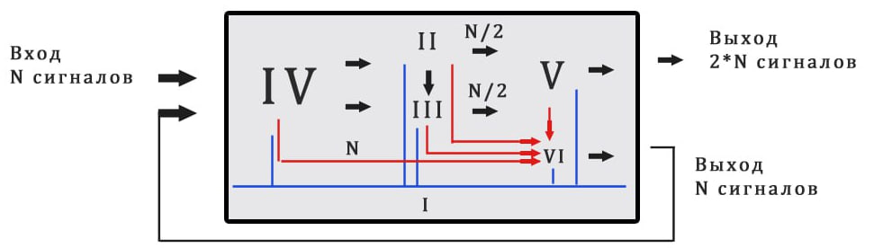

*Редакторское описание (не подпись из DOCX): Схема прохождения N входных сигналов и 2N выходных сигналов [Полный размер PNG](media/image31.png).*

Если мы не будем учитывать влияние на модель сигнала из других областей, то она сводиться к следующей схеме.

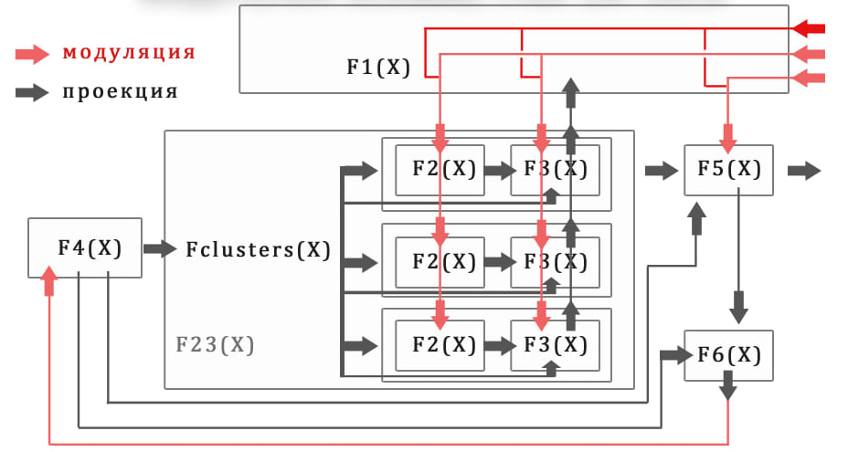

*Редакторское описание (не подпись из DOCX): Схема функций F4, Fclusters, F2/3, F5, F6 с проекциями и красной модуляцией [Полный размер PNG](media/image32.png).*

Сделаем абстрактное описание модели.

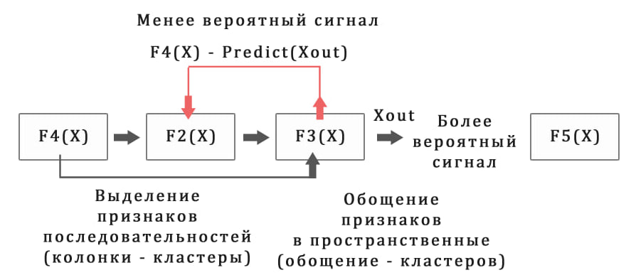

*Редакторское описание (не подпись из DOCX): Упрощённая цепочка функций и остаточный сигнал F4(X)−Predict(Xout) [Полный размер PNG](media/image33.png).*

Точно такой же подход

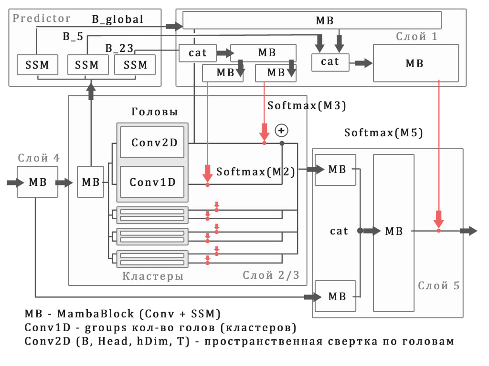

*Редакторское описание (не подпись из DOCX): Подробная схема MB, SSM, Conv1D/Conv2D и Softmax(M2/M3/M5) [Полный размер PNG](media/image34.png).*

Мы можем описать архитектуру модели следующим образом.

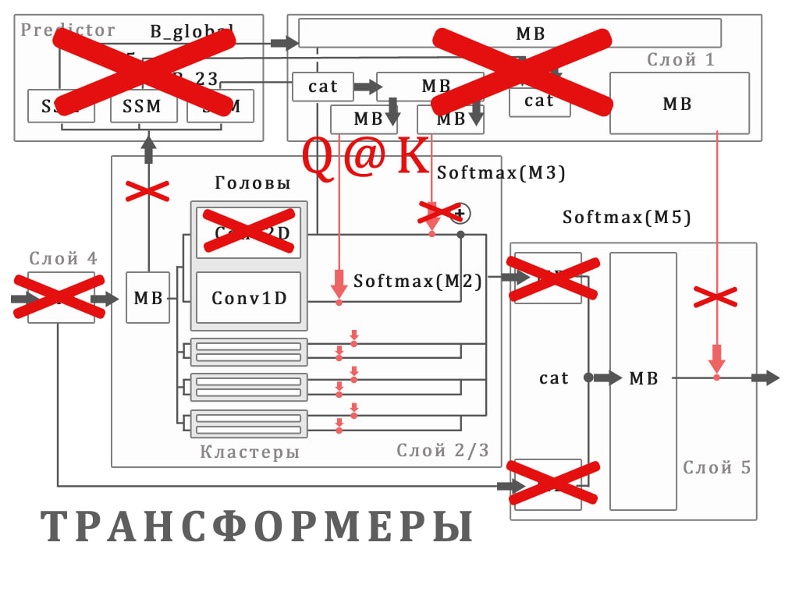

*Редакторское описание (не подпись из DOCX): На многоблочной схеме красными крестами отмечены исключённые узлы [Полный размер PNG](media/image35.png).*

Если мы уберем часть архитектуры и упростим ее, то получим трансформер.

## S12. Флуктуации, закон Вебера и биологические параллели

### **Флуктуация (стохастичность):**

Мы интегрируем шум на уровне функций активации, используя уровень 10% от входного сигнала, что соответствует биологическим и когнитивным закономерностям, выявленным в исследованиях речи и нейронауке. Такой подход не только предотвращает переобучение, но и имитирует естественные процессы, характерные для живых систем.

В современных исследованиях общепризнано, что введение случайности при обучении нейросетей повышает их обобщающую способность и препятствует переобучению. Например, техника Dropout (случайное отключение нейронов) «предотвращает переобучение и обеспечивает приближённое объединение экспоненциально многих различных архитектур нейросетей». Как отмечает Zhiyi et al. (NeurIPS 2017), регуляризация с помощью шума – распространённый приём для повышения обобщения, а Dropout является лишь одним из вариантов: она «случайно выключает часть скрытых единиц сети, умножая на шум, сгенерированный по Бернулли». В общем виде «введение шума при обучении создаёт компромисс между подгонкой к данным и регуляризацией: больше шума затрудняет подгонку, меньше – ослабляет регуляризацию». Сходные идеи подтверждаются широким спектром подходов: добавление гауссова шума на входы/активации, адаптивные варианты Dropout, помехи весам и др. так же приводят к лучшему обобщению.

Кроме того, специально стохастические функции активации оказываются эффективны: например, «Gaussian Process Neurons» вводят для каждой функции активации стохастическую структуру (GP-приор), что «позволяет эффективно учитывать неопределённости во входах и контролировать сложность модели для предотвращения переобучения». Авторы отмечают, что их модель «показывает производительность, сравнимую или лучшую по сравнению с нейросетью с Dropout». Также отмечается, что стохастичность в сети повышает устойчивость: сети, обученные с шумом, «охватывают больше состояний сети, что облегчает обучение и адаптацию в меняющихся условиях». Существует и биологический аналог: в нейронах обнаружено явление стохастического резонанса, при котором оптимальный уровень шума улучшает обнаружение слабых сигналов.

Таким образом, и эмпирически, и теоретически доказано, что «шум на уровне ~10%» (и выше) во многих случаях улучшает обобщение нейросетей и устойчивость результатов

Мы добавляем флуктуацию при обучении, как важное свойство. Флуктуации (шум) отражают естественную вариативность синаптической передачи и нейронных потенциалов.

- Нейроны в биологическом мозге подвержены спонтанным флуктуациям (шуму) на уровне мембранного потенциала.

- Мы моделируем это через «мультипликативный шум», добавляемый к входу перед активацией.

- Это способствует лучшей обобщающей способности модели, не позволяя ей зафиксироваться на частных примерах.

*Редакторское описание (не подпись из DOCX): Две трёхмерные траектории как иллюстрация хаотической динамики [Полный размер PNG](media/image36.png).*

### **Теория хаоса и неопределенность в системах**

Теория хаоса демонстрирует, что даже детерминированные системы могут быть чувствительны к начальным условиям, делая их долгосрочное прогнозирование невозможным. В контексте нейронных сетей это означает, что точное «сходимость» к одному решению может привести к переобучению, так как модель застревает в локальных минимумах.

**Эргодическая теория** показывает, что шум позволяет системе исследовать фазовое пространство, избегая локальных экстремумов.

А **стохастический резонанс** (Gammaitoni et al., 1998) доказывает, что добавление шума может усиливать слабые сигналы в нелинейных системах, улучшая обнаружение паттернов.

Поэтому флуктуации на уровне 10% создают «хаотический бассейн» вокруг оптимального решения, заставляя сеть обобщать данные, а не запоминать их. Это аналогично механизму стохастического градиентного спуска (SGD), где шум в мини-батчах способствует выходу из локальных минимумов.

### **Закон Вебера и относительная чувствительность**

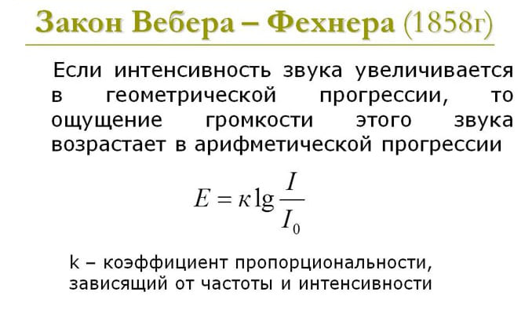

*Редакторское описание (не подпись из DOCX): Заголовок, формула E = k lg(I/I0) и поясняющий текст [Полный размер PNG](media/image37.png).*

Закон Вебера утверждает, что минимально заметное различие между стимулами пропорционально исходной величине.

Для времени пауз в речи этот порог составляет ~10% (длительность паузы воспринимается одинаково в диапазоне ±10%).

### **Биологический параллелизм**

В нейросетях добавление шума в размере 10% от входного сигнала имитирует адаптацию к естественным вариациям данных.

Нейробиологические исследования подчёркивают, что биологические сенсорные и когнитивные системы функционируют при существенной внутренней «погрешности» и флуктуациях. Так, Faisal et al. отмечают, что «вариабельность – характерная особенность поведения» и что на нейронном уровне при прочих равных условиях наблюдается значительная вариативность ответов. Например, ионные каналы генерируют джиттер спайков, синаптические шумы формируют мимопотенциал, а передача сигналов ограничена квантованием. Даже на уровне чувствительности рецепторы работают с пуассоновским шумом: фотонный шум приводит к тому, что пороговая контрастная чувствительность находится под ограничением закона сохранения информации. Моделирование биологических сетей показывает, что их устойчивость сохраняется до уровней шума порядка десятков процентов. В модели дифференцировки T-клеток, описывающей клеточные сети, «сеть остаётся относительно стабильной при высоком уровне шума (~20%), а только при дальнейшем его повышении функционалы клеток резко разнородятся». То есть система может нормально работать при флуктуациях около 10–20%, что согласуется с гипотезой об «ограниченном беспорядке» (Constrained Disorder) в биологии. В целом, можно утверждать: для большинства биологических сенсорных и когнитивных процессов норма – наличие значительных внутренних шумовых флуктуаций (порой порядка 10–20%), которые организм умеет компенсировать или использовать.

Исследования нейронных кодов (Zemel et al., 1998) показывают, что мозг использует относительные сигналы для обработки информации, что согласуется с нормализацией входных данных перед добавлением шума.

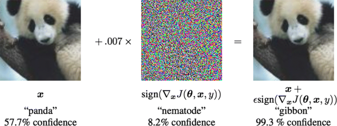

*Редакторское описание (не подпись из DOCX): Изображение панды, малое возмущение и ошибочная классификация gibbon [Полный размер PNG](media/image38.png).*

Например, в компьютерном зрении методы аугментации с изменением яркости/контраста на 10% повышают обобщение (Shorten & Khoshgoftaar, 2019).

### **Ошибки систем на разных уровнях: мета-исследования Сапольского**

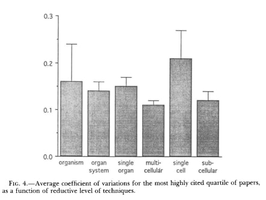

*Редакторское описание (не подпись из DOCX): Столбцы коэффициента вариации по нескольким биологическим уровням [Полный размер PNG](media/image39.png).*

Роберт Сапольский в своих работах («Reductionism and Variability in Data: A Meta-Analysis» Robert Sapolsky & Steven Balt) подчеркивает, что биологические системы имеют встроенные ошибки (около 18%) на всех уровнях — от генетических мутаций до поведенческих реакций. Эти ошибки не являются дефектами, а обеспечивают гибкость и устойчивость к внешним факторам.

В аналогия с нейросетями, Шум в функциях активации моделирует «биологическую избыточность», позволяя сети адаптироваться к вариациям входных данных.

Исследования робастности нейросетей (Zhang et al., 2019) демонстрируют, что добавление шума в активации повышает устойчивость к атакам с переносом и шумовым искажениям.

Хотя Сапольский указывает на 18%, в речевых данных мы наблюдаем более низкий порог (10%), что связано с ограничениями артикуляционного аппарата и когнитивной обработки. Это согласуется с гипотезой о том, что разные системы имеют свои оптимальные уровни шума.

## S13. Фазовое пространство градиентов и иерархия пауз

### **Фазовое пространство градиентов частоты речи**

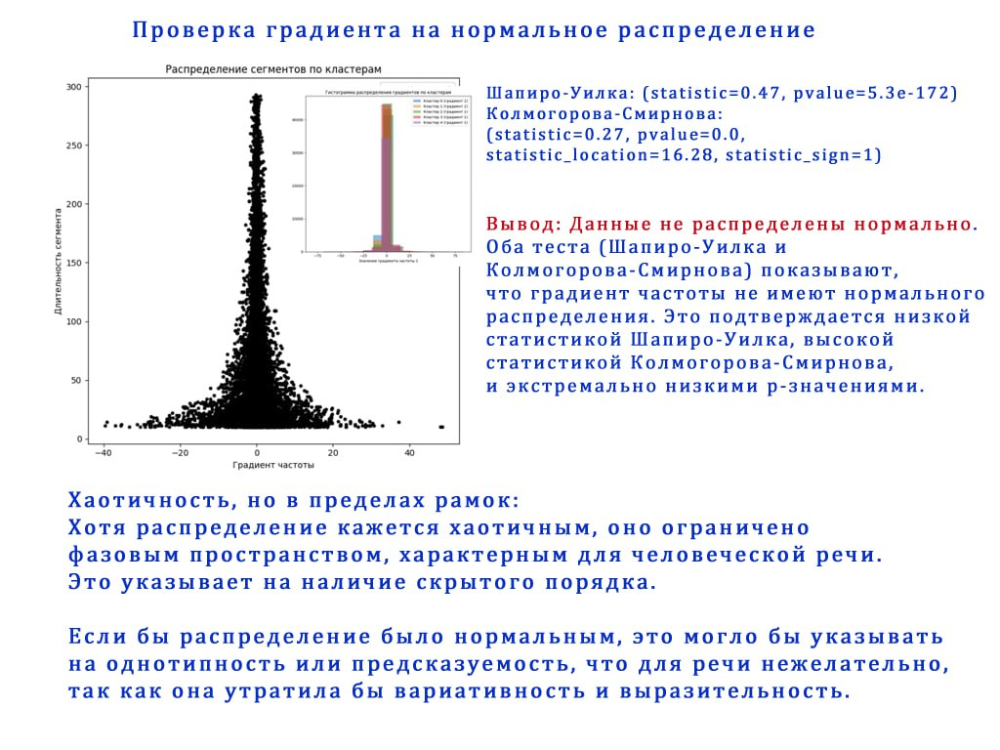

*Редакторское описание (не подпись из DOCX): График, мини-гистограмма и результаты Шапиро–Уилка и Колмогорова–Смирнова [Полный размер PNG](media/image40.png).*

Наше исследование показало, что фазовое пространство градиентов частоты речи для разных организмов сходится к универсальному аттрактору, напоминающему нормальное распределение, но с хаотичными границами.

Вычитание нормального распределения из фазового пространства оставляет «остаточный шум», который представляет хаотичные колебания.

Эти флуктуации аналогичны дрейфующим градиентам в нейросетях, где шум предотвращает стабилизацию весов в одном направлении.

В схожих работах по анализу временных рядов (Kantz & Schreiber, 2004) показывают, что хаотичные системы требуют учета шума для корректного моделирования.

В обработке речи методы, учитывающие нестационарность данных (например, LSTM с шумом), демонстрируют лучшие результаты (Graves et al., 2013).

### **Иерархия пауз в речи и закон Вебера**

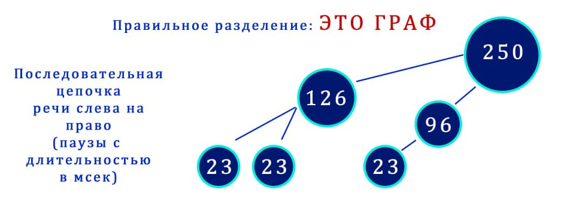

*Редакторское описание (не подпись из DOCX): Иерархия пауз речи с примерами 250, 126, 96 и 23 мс [Полный размер PNG](media/image41.png).*

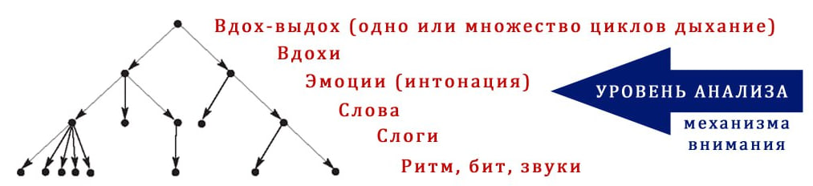

*Редакторское описание (не подпись из DOCX): Дерево уровней от дыхания и эмоций к словам, слогам и звукам [Полный размер PNG](media/image42.png).*

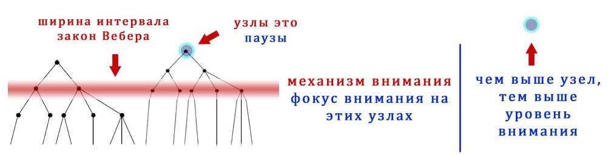

*Редакторское описание (не подпись из DOCX): Деревья пауз и полоса интервала Вебера с фокусом внимания [Полный размер PNG](media/image43.png).*

Паузы в речи образуют иерархическую структуру (звуки → слоги → слова → синтагмы), где длительность паузы варьируется в пределах 10% для восприятия на одном уровне.

Работы по когнитивной лингвистике (Levelt, 1983) подтверждают, что планирование речи включает стохастические процессы на разных уровнях.

В NLP методы временных аугментаций (например, случайное удлинение токенов) улучшают обобщение (Ko et al., 2015).

Так как мы ориентируемся на LLM модели, которые являются следствием речи, поэтому использование 10% для флуктуации на основе интервала Вебера для пауз речи вполне оправдано.

Так же данный подход, косвенно подтверждён другими исследования. DropConnect (Wan et al., 2013): случайное обнуление весов во время обучения, аналогично добавлению шума в активации.

Label smoothing (Szegedy et al., 2016): мягкое представление меток, имитирующее неопределенность данных.

Bayesian Neural Networks (Blundell et al., 2015): учет неопределенности в весах через распределения, что близко к добавлению шума.

## S14. Функции активации с флуктуациями

### **Модификация функций активации: интеграция флуктуаций**

Для реализации биологически обоснованного подхода к добавлению шума в нейронные сети были доработаны базовые функции активации, включая сигмоиду , GELU , Softmax , Softplus и SiLU (Swish) . Эти модификации основаны на двух ключевых принципах:

Мультипликативный шум , пропорциональный величине входного сигнала.

Контекстная чувствительность , имитирующая нелинейные реакции нейронов на стимулы. Ниже представлены основные функции и их биологическое обоснование.

### **Сигмоида с флуктуациями (SigmoidFluct)**

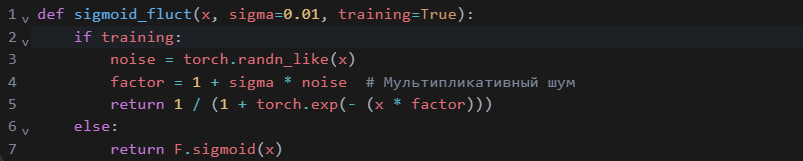

*Редакторское описание (не подпись из DOCX): Python-код sigmoid_fluct и мультипликативного шума при обучении [Полный размер PNG](media/image44.png).*

Мембранный потенциал нейрона подвержен случайным колебаниям из-за стохастического открытия ионных каналов и синаптической передачи.

Мультипликативный шум (σ = 0.01) моделирует вариации чувствительности нейрона к входным сигналам, усиливая обобщающую способность сети.

Это изменение, создает устойчивость к малым возмущениям входных данных.

Предотвращение насыщения сигмоиды за счет случайных отклонений в области порога активации.

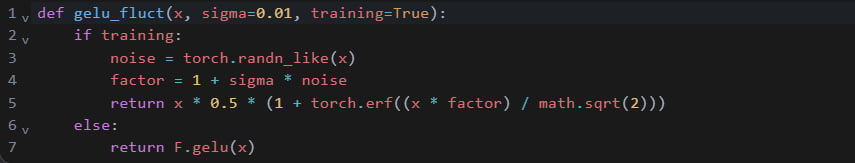

*Редакторское описание (не подпись из DOCX): Python-код gelu_fluct с множителем шума и erf [Полный размер PNG](media/image45.png).*

Аналогичное действие мы проводим со всеми функциями активации. Все эти доработки ведут к:

- Сохранение нелинейности функции при улучшении градиентного потока.
- Снижение переобучения за счет случайных отклонений в области перехода от линейной к насыщенной зоне.

Подобные функции реализованы для Softmax с температурными флуктуациями. Так как нейронные популяции демонстрируют изменчивость в чувствительности к стимулам, что можно смоделировать через температурные флуктуации.

Повышение температуры (T > 1) делает распределение более плоским («неуверенное»), снижение (T < 1) — более резким («уверенное»). Это приводит:

- Улучшение калибровки вероятностей.
- Устойчивость к шумовым артефактам в выходных распределениях.

А также Softplus и SiLU с флуктуациями. Softplus и SiLU моделируют активность нейрона с положительной обратной связью. Добавление шума отражает стохастичность в процессах деполяризации и реполяризации. Это улучшает:

- Сохранение гладкости функции при улучшении устойчивости к выбросам.
- Ускорение сходимости за счет случайных отклонений в градиентном спуске.

### **Мультипликативный шум vs. аддитивный**

В отличие от аддитивного шума (x + ε), мультипликативный шум (x ⋅ (1 + σ ⋅ ε)) сохраняет масштаб активаций, что критично для стабильности глубоких сетей. Это соответствует биологическим системам, где вариации сигнала пропорциональны его интенсивности (например, закон Вебера для восприятия времени пауз).

Флуктуации модулируются текущей активностью нейрона, что отражает физиологические процессы:

- Увеличение шума в области порога активации (для сигмоиды и GELU).
- Изменение контраста распределения вероятностей (для Softmax).

Во время тестирования шум отключается, что обеспечивает детерминированность предсказаний. Это аналогично нейробиологическому принципу: в стабильных условиях мозг минимизирует случайные отклонения.

При сравнение с существующими методами:

*Dropout**:* Использует случайное обнуление нейронов, тогда как флуктуации сохраняют все связи, но вносят непрерывный шум.

*BatchNorm** + **Noise**:* Нормализация активаций с последующим добавлением шума. Наш подход не требует дополнительных слоев.

*Bayesian**Neural**Networks**:* Моделируют неопределенность через распределения весов. Флуктуации в активациях — более легковесная альтернатива.

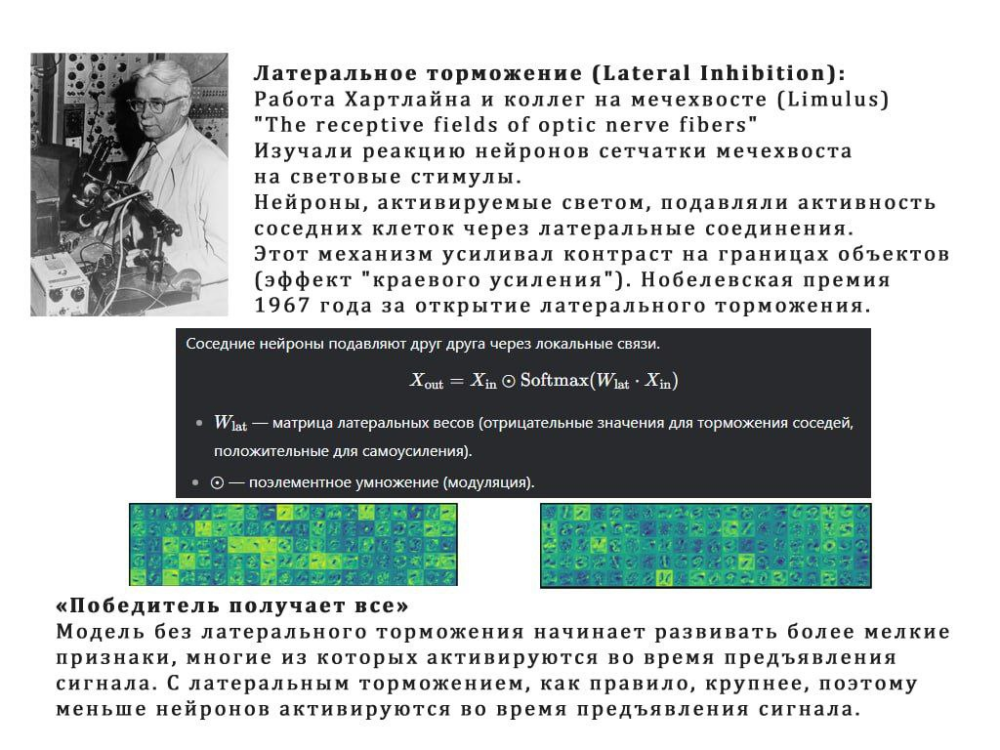

*Редакторское описание (не подпись из DOCX): Коллаж учёного, активностей нейронов и пояснений о lateral inhibition [Полный размер PNG](media/image46.png).*

## S15. Контрастность и селективное усиление

### **Контрастность (селективность нейронов):**

*Редакторское описание (не подпись из DOCX): Фото львов с текстом об экономии ресурсов и Howard et al. (2012) [Полный размер PNG](media/image47.png).*

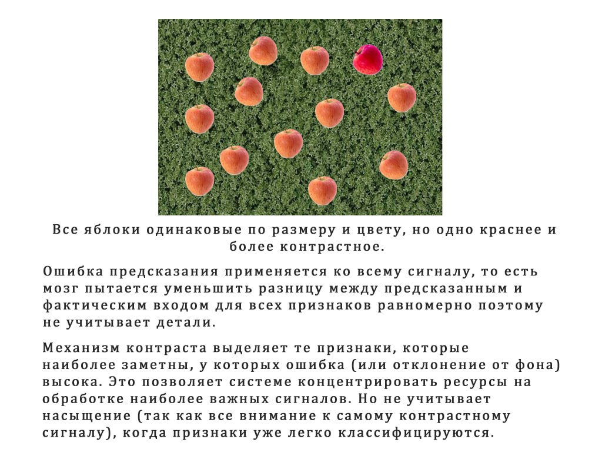

*Редакторское описание (не подпись из DOCX): Фото яблок с одним ярко-красным и текст о контрастном отборе [Полный размер PNG](media/image48.png).*

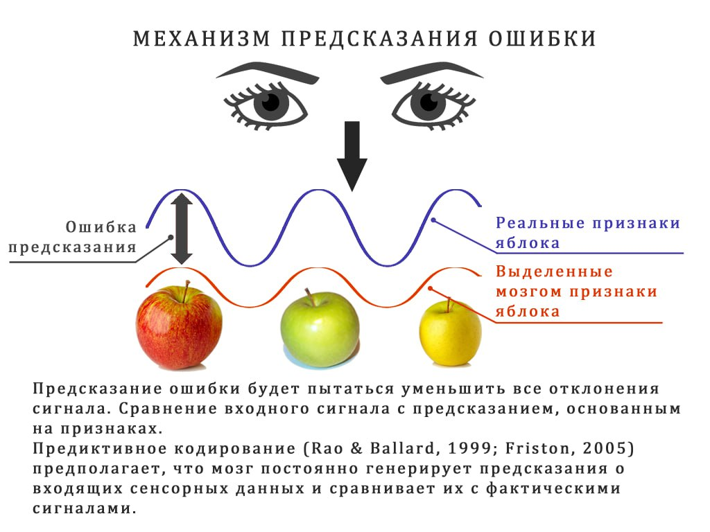

*Редакторское описание (не подпись из DOCX): Глаза, реальные и предсказанные признаки яблок, волны и ошибка [Полный размер PNG](media/image49.png).*

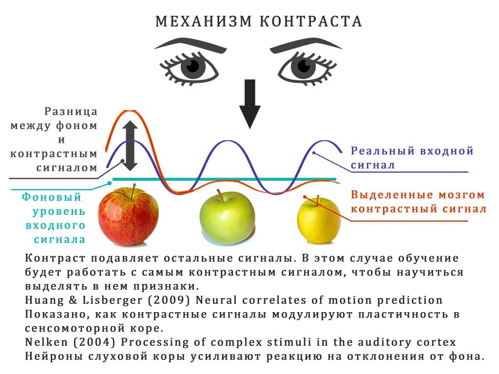

*Редакторское описание (не подпись из DOCX): Глаза, фон и выделенный контрастный сигнал, отсылки к исследованиям [Полный размер PNG](media/image50.png).*

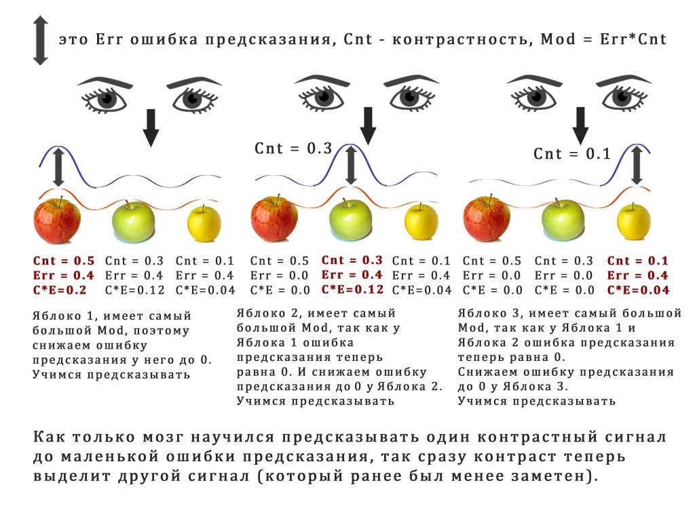

*Редакторское описание (не подпись из DOCX): Три кадра с волнами и яблоками, величины Cnt, Err и смена важного сигнала [Полный размер PNG](media/image51.png).*

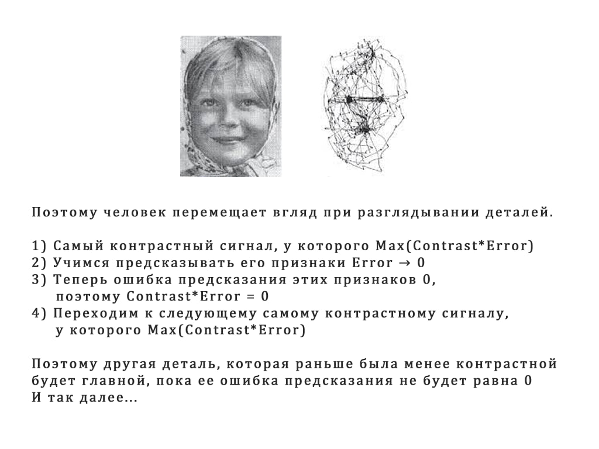

*Редакторское описание (не подпись из DOCX): Фотография лица и сеть взглядов с нумерованными шагами внимания [Полный размер PNG](media/image52.png).*

Softmax реализует контрастную селективность — усиление "победителя" среди конкурирующих сигналов.

- Softmax используется как аналог латерального торможения в коре: он усиливает контраст между активностями нейронов, подавляя менее активные.

- Это приближает модель к механизмам избирательного внимания и нейронной конкуренции.

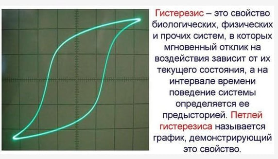

*Редакторское описание (не подпись из DOCX): График петли гистерезиса и текст о зависимости отклика от предыстории [Полный размер PNG](media/image53.png).*

## S16. Мембранная инерция и HysteresisResidual

### **Гистерезис (мембранная инерция):**

Гистерезис — физическое явление, при котором состояние системы зависит от её предыдущих состояний. В контексте нейронных сетей это позволяет модели учитывать историю изменений сигнала, что особенно важно для обработки временных рядов, речи или других волновых данных. В этом разделе мы представляем HysteresisResidual — архитектурный блок, заменяющий классические residual-соединения и интегрирующий гистерезис через три ключевые характеристики волны: амплитуду, частоту и фазу. Такой подход усиливает способность модели к запоминанию долгосрочных зависимостей и адаптации к нелинейным изменениям данных.

### **Физическая основа гистерезиса и его перенос в нейросети**

Гистерезис широко изучается в физике (например, в магнетизме или упругих материалах), где выходная система реагирует на текущий вход не мгновенно, а с задержкой, зависящей от предыдущих состояний. Например, намагниченность ферромагнетика зависит от истории приложенного магнитного поля, образуя «петлю гистерезиса».

В нейронных сетях: Гистерезис моделирует зависимость активации нейрона от его предыдущего состояния. Это особенно полезно для задач, где важна динамика изменений (например, речь, видео, финансовые данные).

Блок HysteresisResidual заменяет классическое residual-соединение **y=f(x)+x** на более сложную формулу, учитывающую историю сигналов:

​

*x**t*​ = (1 + *α*total​) ⋅ *x*prev​ + (1 − *α*total​) ⋅ *x**t*​ ,

где αtotal — адаптивный коэффициент, зависящий от амплитуды, частоты и фазы.

### **Реализация HysteresisResidual**

Класс HysteresisResidual реализует гистерезис через три компоненты:

Амплитуда : Отслеживает рост или падение сигнала.

Частота : Анализирует скорость изменений между текущим и предыдущим состоянием.

Фаза : Учитывает направление движения сигнала относительно порога (например, 0.5).

### **Параметры гистерезиса**

Для каждой компоненты определены параметры αRISE и αFALL , которые регулируют чувствительность к возрастанию/убыванию сигнала.

Веса компонент (WAMP, WFREQ, WPHASE) обучаемые, нормализуются через Softmax для балансировки вклада.

Формула гистерезиса

Общий коэффициент αtotal рассчитывается как:

*Α*total ​= *w*amp ​ ⋅*α*amp ​+ *w*freq​ ⋅ *α*freq ​+ *w*phase ​ ⋅*α*phase​,

где:

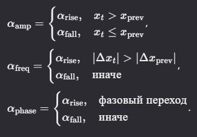

*Редакторское описание (не подпись из DOCX): Кусочные формулы αamp, αfreq, αphase с условиями rise и fall [Полный размер PNG](media/image54.png).*

Финальный выход:

*x**t*​= ( 1 + *α*total ​) ⋅ *x*prev ​+ ( 1 – *α*total ​) ⋅ *x**t*​

Эта формула создает «память» о предыдущих состояниях, что усиливает устойчивость к шуму и улучшает обобщение.

Для гибкости реализованы функции, работающие независимо:

*hysteresis_**amplitude* : Учитывает рост/падение амплитуды.

*hysteresis_**frequency* : Анализирует скорость изменений (частоту).

*hysteresis_**phase* : Реагирует на фазовые переходы (например, смену направления сигнала).

Эти функции могут использоваться отдельно для задач, где доминирует одна из характеристик (например, обнаружение резких скачков частоты в аудиосигналах).

## S17. Волновые свойства и пример амплитудного гистерезиса

### **Связь с волновой природой данных**

Гистерезис напрямую связан с волновыми свойствами сигналов:

- Амплитуда: Определяет интенсивность сигнала (например, громкость речи).
- Частота: Отражает скорость изменений (например, темп речи или движение в видео).
- Фаза: Указывает положение волны относительно порога (например, начало паузы в речи).

Добавление гистерезиса позволяет модели имитировать биологическую память (например, нейронные цепочки, запоминающие предыдущие состояния) и лучше обрабатывать нестационарные данные (где важна история изменений).

### **Преимущества перед классическим Residual**

Память о предыдущих состояниях : В отличие от residual y=f(x)+x, HysteresisResidual использует динамический коэффициент, зависящий от истории.

Адаптивность: Веса компонент (амплитуда, частота, фаза) обучаемые, что позволяет модели самой выбирать важные характеристики.

Устойчивость к шуму : Гистерезис сглаживает резкие колебания, сохраняя долгосрочные зависимости.

HysteresisResidual расширяет возможности нейронных сетей, добавляя память о предыдущих состояниях через амплитуду, частоту и фазу. Этот подход особенно эффективен для задач с волновой природой данных, где важна история изменений.

### **Рассмотрим на примере амплитудного гистерезиса**

**Гистерезис** моделирует **временную инерционность** нейрона: он не реагирует мгновенно, а накапливает или подавляет входной сигнал в зависимости от стабильности.

- Нейроны обладают инерцией: их реакция зависит от предшествующей активности.

- Гистерезис реализуется через разные коэффициенты "роста" и "спада" (alpha_rise, alpha_fall).

- Это позволяет выделять устойчивые сигналы на фоне шумовых колебаний, приближаясь к механизму детектирования значимых признаков.

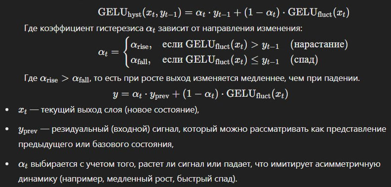

*Редакторское описание (не подпись из DOCX): Формулы GELU_hyst, αrise, αfall, yprev и новые состояния [Полный размер PNG](media/image55.png).*

Это механизм работы нейронов, который за счет разной скорости спада и роста сигнала позволяет выделить важный сигнал из шума. Шумный сигнал будет гасит рост, а стабильный рост сигнала позволяет выделить важный сигнал в нем. Это приводит к выделению признаков.

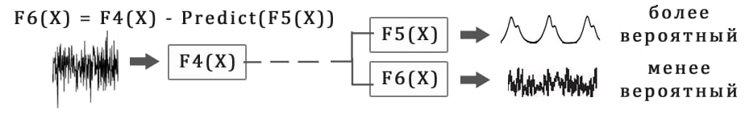

*Редакторское описание (не подпись из DOCX): Формула F6(X)=F4(X)−Predict(F5(X)) и схемы более и менее вероятного сигналов [Полный размер PNG](media/image56.png).*

Мы рассматриваем шестислойную\ модель как функцию гистерезис.

