# Два типа речи

Авторский документ. Текст, изображения, разметка блоков и основные элементы форматирования сохранены по HTML-редакции.

[Оригинал DOCX](../../raw/%D0%B4%D0%B2%D0%B0%20%D1%82%D0%B8%D0%BF%D0%B0%20%D1%80%D0%B5%D1%87%D0%B8.docx) · [Редакторский разбор](review.md)

---

Рассмотрим подробнее два типа речи — монологическую и диалогическую.

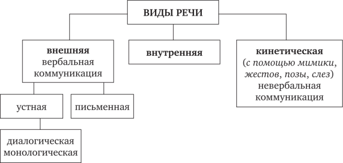

*Рисунок 1. Виды речи. [Рис. 4.7 из главы «Речь и язык» учебника «Психология и педагогика в высшей школе»](https://studme.org/408680/psihologiya/rech_yazyk). [Открыть в полном размере](./media/image1.png)*

Диалогическая речь состоит из более коротких фраз, отличается большей эмоциональностью и служит прежде всего для передачи эмоционального состояния. Монологическая речь служит прежде всего для передачи информации. Чтобы передать информацию, нам нужно продумывать, что мы говорим. В диалоге мы прежде всего выражаем текущее эмоциональное состояние или эмоциональную реакцию, поэтому обдумывание речи отходит на второй план.

Мы знаем, что ритм речи может быть стабильным и нестабильным. Речь идёт о коротких промежутках стабильности и нестабильности на одном выдохе. На следующем выдохе ритм корректируется.

## Диалогическая речь — эмоциональная, монологическая — информативная

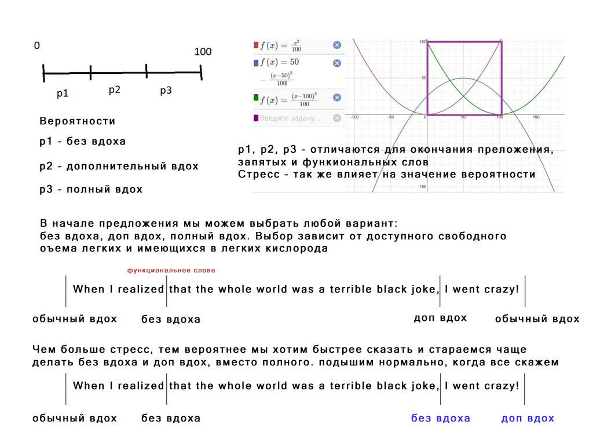

*Рисунок 2. Три варианта дыхания в речи — без вдоха, дополнительный вдох и полный вдох. [Открыть в полном размере](./media/image2.png)*

Нестабильность связана с нарушением темпа. Вместо обычного цикла вдоха и выдоха возможны пауза без вдоха, дополнительный вдох или полный вдох и выдох. Выбор меняет распределение пауз, влияет на скорость речи и корректирует её темп на каждом новом шаге.

Мы сейчас говорим прежде всего о ритме речи. Эмоции сильно влияют на ЧСС и ЧДД. Из исследований мы знаем, что при сильных эмоциях ЧСС коррелирует с периодами колебаний высоты тона. Эти колебания задают ритм, выделяя отдельные слова.

Минимальный блок речи укладывается в цикл дыхания, и эмоциональная речь сохраняет стабильность в пределах одного блока. Есть два уточнения.

- В эмоциональной речи упор делается на **передачу эмоций**, а не на логическую структуру.
- За счёт этого ритм внутри блока может меняться, но его завершение привязано к дыхательному циклу.

## Выбор между типами дыхания

Для эмоциональной речи характерен непредсказуемый выбор между полным выдохом и вдохом, одним вдохом или продолжением речи без вдоха.

- Речь **прерывается паузами** в местах, определяемых логикой эмоционального выражения (слова-якоря, пунктуация, конец предложения).
- Речь **допускает отступления от обычного дыхательного ритма** ради передачи эмоций. Краткий вдох, например, позволяет продолжить фразу.

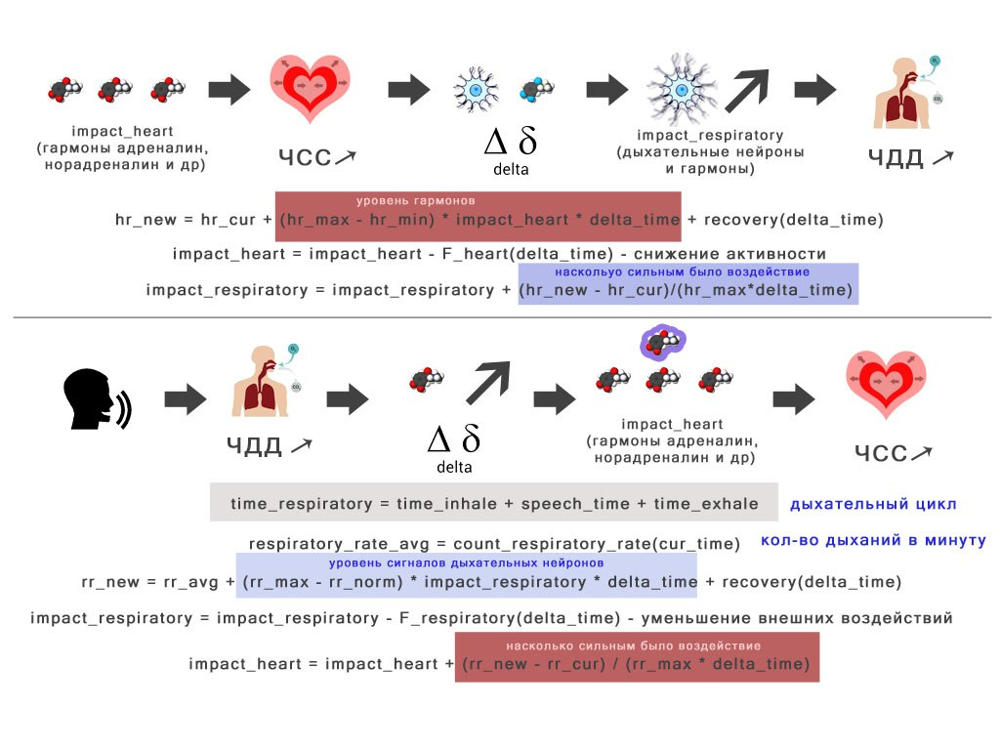

*Рисунок 3. Схема предлагаемой модели связи частоты сердечных сокращений и частоты дыхания в речи. [Открыть в полном размере](./media/image3.png)*

Стабильный ритм речи коррелирует с ЧСС и ЧДД. При синтезе такая речь звучит как монологическая, а её темп регулируется содержанием высказывания. В этом случае мозг регулирует текущие ЧСС и ЧДД. Эмоции в речи прежде всего помогают выделить значимую информацию.

При диалогической речи человек говорит бессознательно, без участия лобной доли. Важны прежде всего эмоции, которые он передаёт словами через изменения ЧСС и ЧДД. Темп речи при этом нестабилен, поскольку человек стремится как можно быстрее сообщить о внешней угрозе или передать своё эмоциональное состояние.

Поэтому речь можно разделить на два типа. В диалогической речи с нестабильным темпом важно передать эмоции. В монологической речи со стабильным темпом важно передать информацию.

## Ритм и темп как инструмент

Ритм и темп становятся **инструментом для ускорения передачи информации** в эмоциональной речи.

- **Эмоциональная речь** быстро передаёт смысл и эмоции, при этом ритм может быть неравномерным.
- **Монологическая речь** использует ритм и темп для чёткой и последовательной передачи информации.

## Диалогическая речь как «бессознательная»

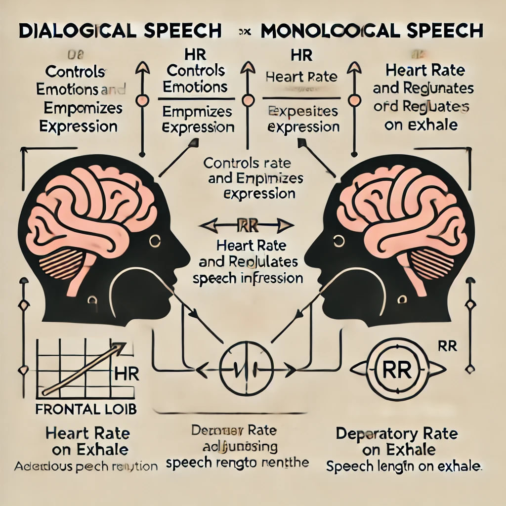

*Рисунок 4. Диалогическая и монологическая речь. HR обозначает ЧСС, RR — ЧДД. Часть английских подписей на исходной схеме искажена и остаётся неразборчивой при увеличении. [Открыть в полном размере](./media/image4.png)*

Лобные доли играют важную роль даже в диалогической речи, поскольку они участвуют в контроле поведения, выборе слов, реагировании на собеседника и регулировании социальных взаимодействий.

В диалогической речи действительно меньше времени на обдумывание, но она не полностью «бессознательная». Здесь скорее активируется система быстрой обработки информации, включая интуитивное и эмоциональное реагирование.

«Бессознательная» речь не означает, что мы совсем не решаем, что сказать. Лобные доли, безусловно, играют роль, но по-другому. Эмоциональная речь прежде всего зависит от текущего состояния организма, уровня гормонов и эмоционального фона. Лобные доли при этом помогают подчеркнуть эмоции.

Речь будет тесно связана с частотой сердечных сокращений, которая при сильных эмоциях регулирует периодичность колебаний высоты тона. Частота дыхания, в свою очередь, коррелирует с длительностью речи на выдохе и паузами на вдохе.

При каждом выдохе и вдохе речь приспосабливается к новым значениям ЧСС и ЧДД. Когда человек испытывает эмоции, он не задумывается, хватит ли ему воздуха, и речь может стать прерывистой. Именно это подразумевается под «бессознательной» речью. Темп бессознательно задаётся ЧДД, а ритм — ЧСС. При монологической речи человек продумывает, что скажет, и регулирует дыхание, темп и ритм, чтобы воздуха хватило на передачу информации.

## Влияние ЧСС и ЧДД на ритм речи

Эмоции напрямую влияют на ЧСС и ЧДД, а через них — на ритм речи.

- ЧСС коррелирует с колебаниями высоты тона (pitch), что может усиливать акцент на ключевых словах и задавать ритмическую структуру.
- ЧДД влияет на длину речевых сегментов: при быстром дыхании выдохи становятся короче, что уменьшает длину фраз.

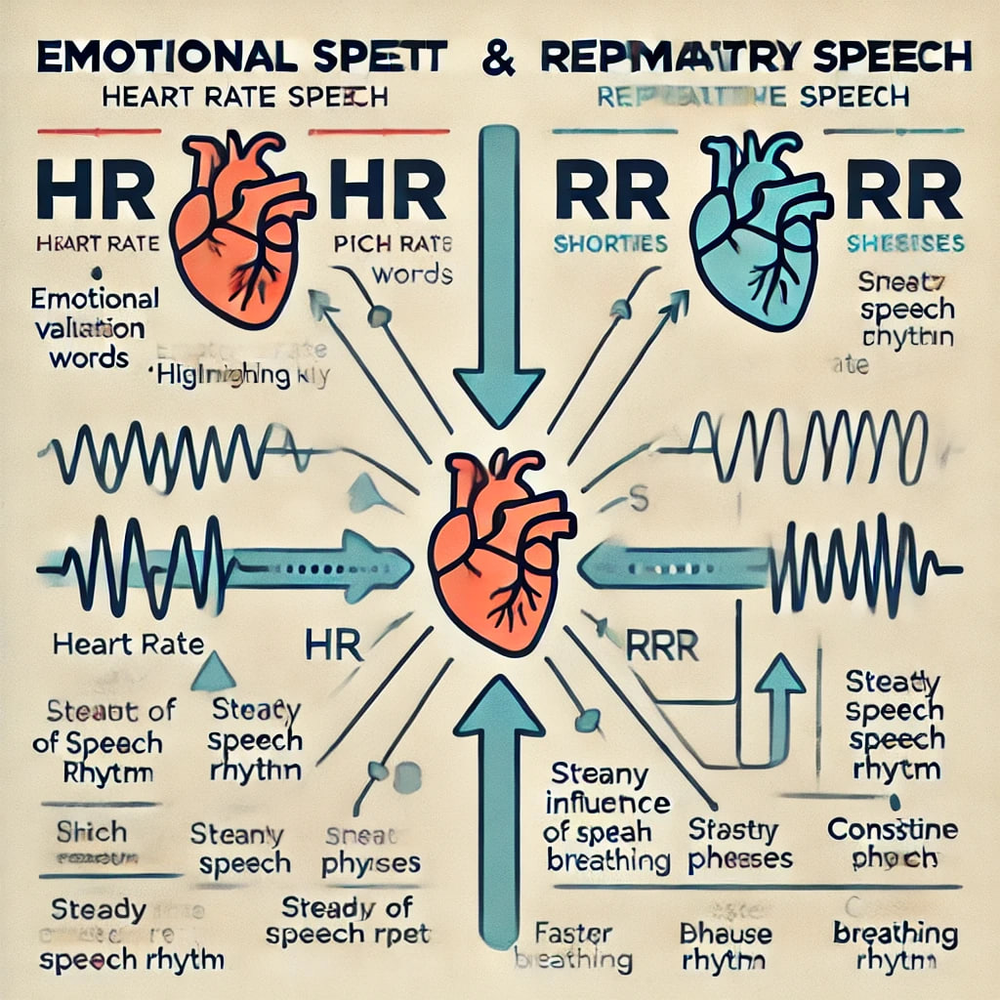

*Рисунок 5. Частота сердечных сокращений, дыхание и ритм речи. HR обозначает ЧСС, RR — ЧДД. Часть английских надписей искажена в оригинале и остаётся неразборчивой при увеличении. [Открыть в полном размере](./media/image5.png)*

В эмоциональной речи влияние ЧСС и ЧДД на ритм сильнее, поскольку организм ориентирован на реакцию. В информативной речи влияние ЧСС и ЧДД снижается за счёт когнитивного контроля.

В эмоциональной речи ЧСС и ЧДД подстраиваются под речь. В информативной речи мы управляем ЧСС и ЧДД, чтобы подстроить под них речь.

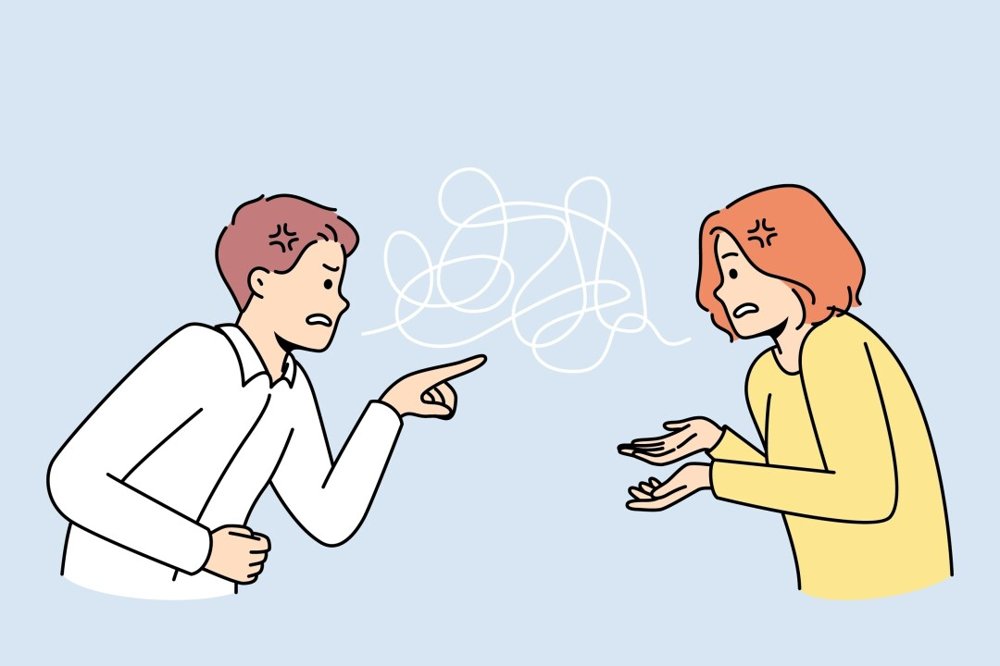

*Рисунок 6. Спор как пример эмоционального диалога. [Иллюстрация из материала Sobaka.ru о токсичном общении](https://www.sobaka.ru/sochi/health/psychology/181719). [Открыть в полном размере](./media/image6.jpeg)*

## Диалогическая речь (эмоциональная)

- Эмоциональная (диалогическая) речь
  - **ЧСС** и **ЧДД** доминируют над произвольным контролем.
  - Речь становится фрагментированной, поскольку человек говорит на выдохе, не всегда предугадывая, хватит ли воздуха. Это приводит к коротким, часто нестабильным фразам.
  - Колебания высоты тона (pitch) усиливаются, создавая акценты на определённых словах для передачи эмоционального состояния.

*Рисунок 7. Публичное выступление как пример монологической речи. [Иллюстрация из статьи школы «Скажи Это» о страхе публичных выступлений](https://krasspeech.ru/blog/strax-publichnyix-vyistuplenij-kak-ego-pereborot). [Открыть в полном размере](./media/image7.jpeg)*

## Монологическая речь (информативная)

- Информативная (монологическая) речь
  - Человек обдумывает, что хочет сказать. Это требует когнитивного контроля, включая планирование дыхания, чтобы длительность выдохов соответствовала длине фраз.
  - Ритм становится более ровным, поскольку цель — передача информации, а не эмоций.
  - Высота тона изменяется в меньшей степени, так как эмоциональная окраска минимальна.

В монологической речи ритм на каждом выдохе *стабилен*, так как когнитивный контроль регулирует ЧСС, ЧДД и структуру речи.

- **Монологическая речь**
  - Эмоции поддерживают передачу информации.
  - Ритм и темп стабильны в пределах выдоха.
  - Усиление затрагивает ключевые слова или фразы.
- **Диалогическая речь**
  - Эмоции доминируют, а информация передаётся через эмоциональный окрас.
  - Ритм и темп нестабильны и сильно зависят от ЧСС и ЧДД.
  - Усиление распространяется на весь эмоционально значимый отрезок речи.

Таким образом, одно и то же предложение действительно будет звучать по-разному в зависимости от типа речи.

## Роль когнитивного контроля

- В эмоциональной речи когнитивный контроль минимален, а ЧСС и ЧДД задают ритм, который часто бывает нестабильным.
- В информативной речи когнитивный контроль максимален. Он стабилизирует ритм и помогает сделать речь понятнее.

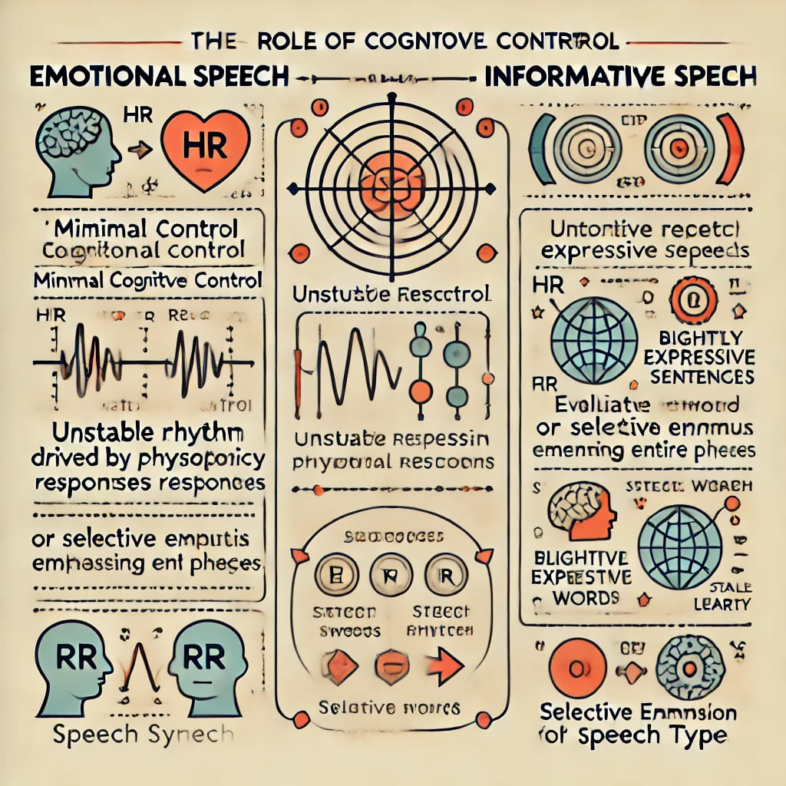

*Рисунок 8. Когнитивный контроль в эмоциональной и информативной речи. Часть английских надписей искажена в оригинале и остаётся неразборчивой при увеличении. [Открыть в полном размере](./media/image8.png)*

При разработке синтеза речи нам нужны два режима. Диалогический режим предназначен для передачи эмоций, а монологический — для передачи информации.

Чтобы определить тип речи, можно оценить эмоциональную окраску всего высказывания или текущий эмоциональный фон.

Если при анализе всего текста ни одна эмоция не выделяется или тон текста нейтральный, значит, нужен синтез монологической речи. Если преобладает какая-то эмоция, нужен синтез диалогической, эмоциональной речи.

Другой подход — учитывать текущий эмоциональный фон. Он зависит от истории эмоций, характера модели и эмоционального контекста вопроса собеседника и ответа модели.

Монологическая речь может быть эмоциональной. При стабильном ритме и темпе эмоции выделяют отдельные слова. В диалогической речи ритм и темп нестабильны, поэтому фраза иначе делится на отрезки, произносимые на одном выдохе, а эмоциональная окраска слов более выражена. В примере «Я был поражён. Это яблоко было необычным фруктом» в монологической речи будет выделено только слово «поражён». В диалогической речи будет выделено всё предложение.

Одно и то же предложение можно произнести по-разному. В одном случае речь передаёт прежде всего эмоции, в другом — информацию, а эмоции выделяют отдельные части текста и задают общий тон.

Пример фразы с радостной интонацией — «Яблоко — это фрукт».

Диалогическая (эмоциональная) речь — «Яблоко! Этооооо фрукт!» Фраза звучит радостно.

Монологическая (информативная) речь — «Яблоко — это фрукт». Фраза передаёт информацию, при этом эмоционально может быть выделено слово «яблоко» или «фрукт». Речь будет звонкой, ближе к радостной.

### Эмоции в монологической речи

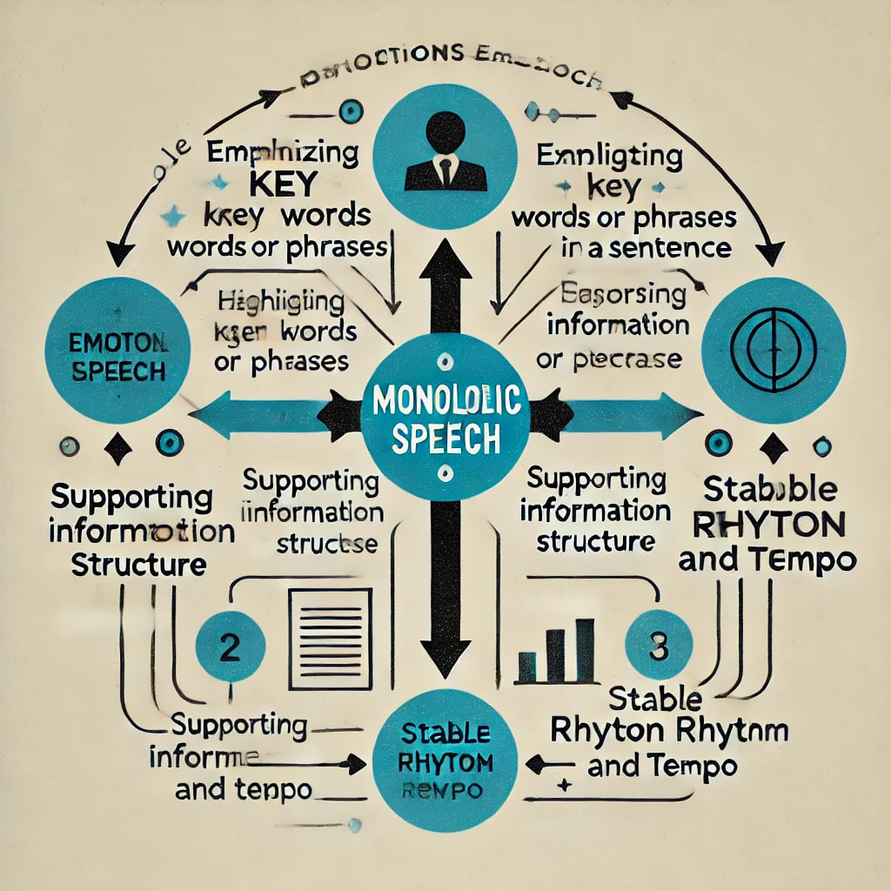

*Рисунок 9. Эмоции в монологической речи выделяют ключевые слова и фразы при стабильном ритме и темпе. Часть английских надписей искажена в оригинале и остаётся неразборчивой при увеличении. [Открыть в полном размере](./media/image9.png)*

- Роль эмоций в **монологической речи**
  - Эмоции помогают выделить **ключевые слова или фразы**, которые несут главную смысловую нагрузку.
  - Эмоции в основном поддерживают структуру передачи информации, помогая слушателю выделить важные моменты.
  - Ритм и темп стабильны, чтобы облегчить восприятие информации.

Пример
*«Я был поражён. Это яблоко было необычным фруктом».*

- В этом случае **выделено слово «поражён»**. Возможно, высота тона слегка повышается или интонация становится напряжённее. Остальная часть фразы произносится в ровном ритме.

### Эмоции в диалогической речи

- Роль эмоций в **диалогической речи**
  - Эмоции выходят на первый план и становятся главным способом передачи информации.
  - Всё предложение окрашивается эмоционально, а ритм и темп становятся нестабильными, чтобы усилить впечатление.
  - Изменения высоты тона, громкости и длительности выражают текущее состояние человека.

Пример
*«Я был поражён. Это яблоко было необычным фруктом».*

- Всё предложение можно подчеркнуть изменениями высоты тона, паузами и растягиванием слов. Ниже приведён пример.
  - **«Я был порааааажен! Это яблокооо… было необычным фруктом!»**

### **Роль ритма и темпа**

Ритм и темп играют ключевую роль в различии между типами речи.

#### Монологическая речь

- **Ритм** стабилен в пределах одного выдоха. Ключевые слова выделяются, а остальная речь звучит ровно.
- **Темп** регулируется так, чтобы было удобно дышать и передавать информацию.

#### Диалогическая речь

- **Ритм** нестабилен и часто меняется в зависимости от эмоций и дыхания.
- **Темп** может резко ускоряться или замедляться для эмоционального акцента.

### Акценты в речи

В монологической речи эмоции подчеркивают **конкретные слова**, а в диалогической — **всё предложение**.

- В **монологической речи** акценты выделяют ключевые слова и **усиливают смысл**.
Пример
  - **«Я был *поражён*. Это яблоко было необычным фруктом».**
- В **диалогической речи** акценты распределяются по всему предложению и передают эмоциональное состояние.
Пример
  - **«Я был пораааажен! Это яблокооо… было необычным фруктом!»**

## Разделение гнева и грусти

Речь при гневе может передавать информацию о его причинах. Однако многое зависит от силы гнева. Если человек сильно разгневан, он не обдумывает, что говорит, и эмоции преобладают. До некоторого уровня эмоциональности речь остаётся монологической, а после его достижения становится диалогической.

При грусти низкая ЧДД сглаживает изменения речи. Когда ЧСС низка, интонация на длинных отрезках выражена слабо. Организм экономит энергию, и артикуляция выражена слабо. Как и при гневе, эмоция может взять верх над монологическим строем речи. Тогда грусть проявляется ярко и может выражаться как горе.

Отсюда две группы эмоциональных состояний. Первая проявляется при сильном стрессе и большом расходе энергии. Для неё характерна выраженная артикуляция, например при радости, злости или страхе. Вторая группа проявляется при небольшом расходе энергии и слабой артикуляции. Её изменения будут незаметны или едва заметны, поэтому речь будет напоминать монотонную.

Тип речи определяется степенью эмоциональности. Если её уровень превышает некоторое значение, артикуляция становится ярче и преобладает эмоциональная речь. При более низком уровне эмоциональности речь остаётся монологической даже при высокой громкости.

### Две группы эмоциональных состояний

Если сила эмоции превышает определённое значение, артикуляция становится ярко выраженной.

Как было сказано выше, эмоции проявляются и в монологической речи. Пока их сила ниже некоторого порога, речь может быть громкой и яркой, сохраняя монологический строй.

Если же сила эмоции превышает этот порог, речь приобретает характерные черты эмоционального диалога.

Таким образом, эмоции могут выражаться в обоих типах речи, но проявляются в них по-разному.

### Эмоциональность как граница между типами речи

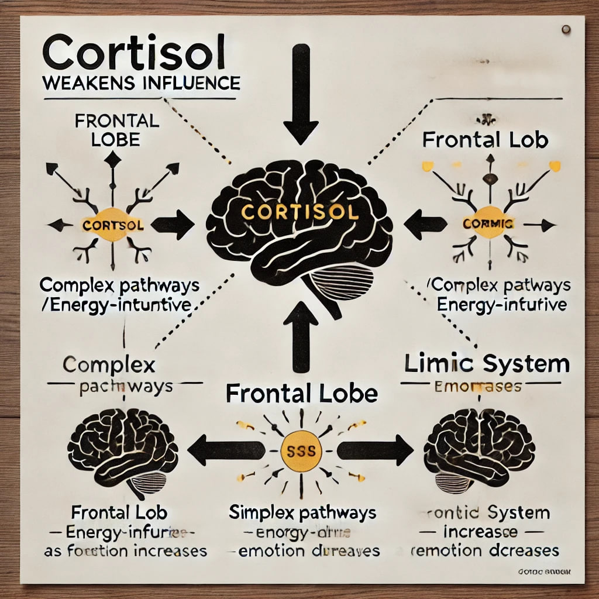

*Рисунок 10. Кортизол и лобные доли в авторской модели переключения между типами речи. Часть английских надписей искажена в оригинале и остаётся неразборчивой при увеличении. [Открыть в полном размере](./media/image10.png)*

Амплитуда речи сама по себе не позволяет провести границу между двумя типами речи. Например, эмоциональную фразу можно произнести шёпотом, и она останется диалогической. Кортизол модулирует работу лобной доли. При высоком уровне кортизола влияние лобной доли уменьшается.

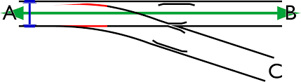

*Рисунок 11. Стрелочный перевод как иллюстрация выбора маршрута сигнала. Уменьшенный кадр с обрезанными полями из [анимации Emdx на Wikimedia Commons](https://commons.wikimedia.org/wiki/File:Funzionamento_Deviatoio.gif), [CC BY 3.0](https://creativecommons.org/licenses/by/3.0/). Анимация также опубликована в [статье «Рельсторга» о стрелочном переводе](https://railstorg.ru/ustrojstvo-i-shema-strelochnogo-perevoda-vidy-neispravnostej/). [Открыть в полном размере](./media/image11.png)*

Лобные доли модулируют работу мозга, усиливая нейронные связи в более сложных и энергозатратных маршрутах. Кортизол ослабляет работу лобных долей.

Можно ввести условный порог уровня кортизола. Когда концентрация кортизола превышает этот порог, лобная доля, формирующая логическую цепочку монологической речи, словно отключается. Доминирующую роль берёт на себя лимбическая система, что проявляется в диалогической речи. Уровень кортизола коррелирует с уровнем стресса. Поэтому в модели высокий уровень кортизола можно выразить через превышение некоторого порога стресса.

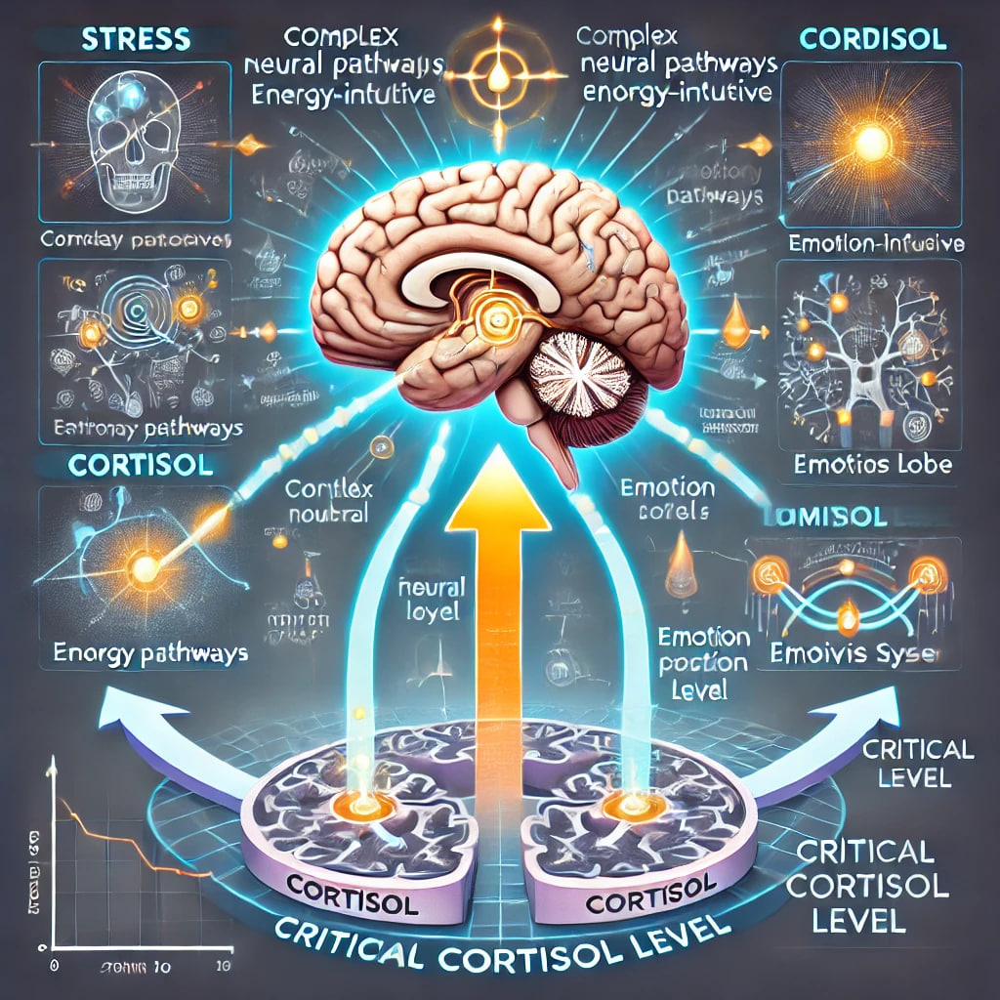

*Рисунок 12. Условный порог уровня кортизола в авторской модели переключения между типами речи. Часть английских надписей искажена в оригинале и остаётся неразборчивой при увеличении. [Открыть в полном размере](./media/image12.png)*

### Классификация эмоций, зависящих от контекста

Эмоциональная речь и выраженность артикуляции зависят и от силы эмоции, и от контекста. Например, яркие эмоции могут подавляться в ситуациях, где важно сохранить контроль. Это зависит от индивидуальных особенностей. Для каждой эмоции можно ввести свой порог, при превышении которого речь становится диалогической. Его можно уподобить обобщённому сигналу от разных участков мозга, который управляет переключением между двумя состояниями для данной эмоции. В этой модели порог задаётся статически. Мы исходим из того, что нейропластичность не проявляется мгновенно и участки мозга не обучаются сразу реагировать на новые стимулы. Поэтому порог переключения для каждой эмоции можно считать постоянным на некотором промежутке, а в нашей модели — на всём её протяжении. Собственный порог для каждой эмоции позволяет описывать индивидуальные особенности говорящего.

Динамическая настройка порога в процессе обучения требует понимания работы каждой зоны мозга и более сложной модели обучения. Поэтому в этой модели пороги статичны и описывают индивидуальные особенности говорящего.

## Авторский разбор работы Сбера

В работах с участием Сбера меня интересует один вопрос — как отделить то, что слышно в голосе, от того, что слушатель понимает из смысла реплики и ситуации.

**Работы по распознаванию эмоций в речи**

- Пресс-релиз Сбера.  [Учёные улучшили распознавание эмоций по голосу с помощью искусственного интеллекта](https://www.sberbank.ru/ru/sberpress/all/article?newsID=82e02842-5bb2-4f1f-99ca-2ca388a2ba86&blockID=1303&regionID=77&lang=ru&type=NEWS)
- Публикация в сборнике ECAI 2024 с результатами оценки на IEMOCAP.  [CA-SER: Cross-Attention Feature Fusion for Speech Emotion Recognition](https://ebooks.iospress.nl/doi/10.3233/FAIA241034)
- Статья SberDevices о сборе и разметке записей и обучении базовых моделей.  [Как создавали датасет Dusha](https://habr.com/ru/companies/sberdevices/articles/715468/)
- Русскоязычный корпус для распознавания эмоций в речи. Репозиторий содержит описание и ссылки для скачивания.  [Датасет Dusha на GitHub](https://github.com/salute-developers/golos/tree/master/dusha#dusha-dataset)

### Как контекст меняет восприятие эмоции

Высота тона, громкость, темп и паузы помогают оценить, как звучит речь. Одна и та же акустическая картина допускает несколько объяснений, поэтому по этим признакам нельзя однозначно восстановить переживаемую эмоцию. Для интерпретации важны смысл слов, ситуация и предыдущие реплики. Например, одну и ту же запись фразы «Вот это да» на фоне хорошей новости можно услышать как радостное удивление, а на фоне угрозы — как испуг.

На восприятие также влияет текущее состояние слушателя. Если он уже тревожится, та же интонация может показаться ему тревожной. Это ожидание слушателя, а состояние говорящего остаётся предметом оценки. Для голосового агента похожую роль может играть его предыдущее состояние. В нашей модели смысл высказывания задаёт возможные интерпретации, а предыдущие события и акустические признаки помогают уточнить текущую реакцию. [Рекуррентная модель эмоционального состояния агента](https://iproxy3d.github.io/emotional-state-agents/#general).

### Неоднозначность разметки Dusha

Разметчики Dusha могли по-разному оценить одну запись. SberDevices отмечает, что увеличение числа оценщиков само по себе не гарантирует согласия. В корпусе четыре основных класса — радость, грусть, злость и нейтральное состояние. Страх отдельным классом не выделялся, а вариант *Other* предназначался для записей с техническими проблемами или без голоса. [Описание Dusha на Хабре](https://habr.com/ru/companies/sberdevices/articles/715468/).

Разметчики слушали записи без доступа к транскриптам. Инструкция просила оценивать голос. Фразу с положительным или отрицательным смыслом, произнесённую спокойно и без эмоциональной окраски, следовало отмечать как нейтральную. При этом в самой записи разметчик слышит и интонацию, и слова. Если целевая метка должна отражать только акустическую окраску, влияние услышанного смысла — возможный источник смещения. Оно возможно и при автоматической разметке по транскрипции, где модель видит слова, а свойства звучания ей недоступны. Вклад смысла в конкретные метки Dusha нужно измерить отдельно. [Кондратенко и соавторы, Interspeech 2023, § 3.3](https://www.isca-archive.org/interspeech_2023/kondratenko23_interspeech.pdf).

На каждую запись приходилось не менее трёх независимых оценок. При разногласиях добавляли разметчиков, а для получения итоговой метки применяли Dawid–Skene с порогом уверенности 0,9. В таблице после агрегации доля нейтральных меток составила 65,0% в постановочной части Crowd и 89,7% в Podcast. Эти доли показывают распределение меток. Акустический разброс внутри каждого класса следует измерять отдельно. По открытым индивидуальным оценкам можно посчитать распределение ответов. В отдельном эксперименте можно сравнить ответы по транскрипту, по исходной записи и по той же записи с дополнительным контекстом. [Методика и таблица 1](https://www.isca-archive.org/interspeech_2023/kondratenko23_interspeech.pdf) · [Препринт](https://arxiv.org/abs/2212.12266) · [Данные и исходная разметка](https://github.com/salute-developers/golos/tree/master/dusha#dusha-dataset).

### Страх как пример акустической изменчивости

Страх может выражаться шёпотом, криком или дрожащим голосом. Куражова (2024) исследовала частоту основного тона, её диапазон, длительность высказываний и пауз в пяти состояниях. В этой выборке максимальные паузы между словами у мужчин наблюдались в речи со страхом. Эксперты распознали страх в 52% таких предъявлений, аудиторы без опыта — в 39%. Описание резких перепадов силы голоса, нарушений мелодического ритма и увеличения пауз Куражова приводит со ссылкой на работу В. П. Морозова (2017) о певческой речи. В её собственных данных акустическая картина различалась между дикторами. [Речь взрослых в разных эмоциональных состояниях](https://journals.rcsi.science/0320-7919/article/view/259707).

В исследовании речи детей 7–8 лет у фрагментов, которые аудиторы правильно отнесли к страху, минимальная частота основного тона в среднем составила 249,7 Гц, а отношение максимальной и минимальной интенсивности — 6,7 ± 9. Эти величины относятся к конкретной выборке. Для нашей задачи важно измерять, как меняются признаки между говорящими и ситуациями, и сопоставлять их с тем, насколько согласны слушатели. [Клешнев, Фролова и Ляксо (2024)](https://journals.rcsi.science/0869-8139/article/view/265023).

К сожалению, я постоянно вижу, как нехватка знаний и понимания того, что скрывается за реальными данными языковых моделей (LLM), мешает понять их поведение и интерпретировать выводы подобных исследований.

Подобное я постоянно замечаю и в работах Яндекса и Сбера, и в области машинного обучения в целом. Отсутствие знаний в других областях часто компенсируют вольными трактовками.

Как связать неоднозначность интерпретации с предлагаемой моделью эмоционального поведения?

Чтобы ответить на эти вопросы, нужно понять, как работает наш мозг и как взаимодействуют его зоны.

Далее я изложу свою гипотезу о механизмах эмоционального поведения.

- лимбическая система
- левое полушарие
- лобные доли
- взаимодействие этих зон и механизмы доминирования

Лимбическая система отвечает за первичные реакции. Речь о реакциях, которые мы можем приобрести при адаптации к окружающей среде, чтобы избегать опасности.

Возьмём страх. В реакции страха участвует несколько зон мозга, через которые последовательно проходит сигнал. Эти зоны задействованы во многих паттернах поведения, от разных видов агрессии до замирания. Это сложный механизм, своего рода «мозг в мозге». Он отвечает за выживание, поиск пищи, размножение и другие функции.

Другой пример — реакция на внутреннее чувство тревожности или спокойствия.

Здесь нас интересует один из механизмов взаимодействия зон мозга через гормоны, белки и другие вещества. Чаще всего они действуют как модуляторы, усиливая сигнал, или выключают отдельные процессы. По сути, это биологические сообщения, которые подсказывают различным зонам мозга и органам, как реагировать. Рецепторы действуют как обработчики таких сообщений. Они реагируют на определённые сигналы, например на отдельные гормоны, и запускают соответствующую реакцию.

Когда лимбическая система активируется, она постоянно побуждает гиппокамп и другие отделы мозга передавать нужные сигналы остальным зонам.

Два таких важных сигнала — норадреналин и кортизол. Остальные я оставлю за рамками статьи, чтобы сосредоточиться на общем принципе.

Норадреналин помогает закрепить нейронные связи. В данном случае он действует как модулятор. Если в ответ на какую-то ситуацию вырабатывается много норадреналина, значит, она может быть важна для выживания и её следует лучше запомнить. Тогда норадреналин усилит условный сигнал с 0,1 до 0,7. Это своего рода фильтр важной информации.

Норадреналин образуется из адреналина при первичной обработке ситуации, прежде чем сигнал поступит в высшие отделы нервной системы.

Например, если нападает хищник, вырабатывается адреналин, а затем норадреналин. Благодаря этому ситуация запоминается.

Кортизол, в свою очередь, действует как тормозящий модулятор и способствует разрушению связей.

Кортизол вырабатывается при длительном стрессе. Вероятно, в этом случае существующие связи неэффективны и их следует ослабить или разрушить, чтобы в дальнейшем сформировать новые.

Например, лимбическая система конкурирует с лобными долями за доминирование. Кортизол тормозит работу лобных долей, ослабляя их участие в общем процессе.

Для чего нужны лобные доли? Они играют важную роль в закреплении поведенческих паттернов, которые помогают адаптироваться к окружающим условиям.

Проще говоря, такие паттерны помогают решать, как вести себя в обществе, стоит ли обманывать и как доказать теорему.

Задача лобной доли — усилить нужные сигналы, например в полушариях. Тогда сигнал пойдёт по длинному маршруту через 30 нейронов вместо короткого через 3 нейрона.

Зачем это нужно?

Длинный маршрут позволяет принять более сложное, взвешенное решение. Он часто включает длинные нейронные цепочки, поэтому сигнал идёт дольше и требует больше ресурсов.

Короткий маршрут позволяет быстро отреагировать на конкретную ситуацию. Вижу Васю — бью в морду. При этом не успеваю обдумать, заслужил ли Вася удар, что будет, если так сделать, и не станет ли от этого хуже мне самому.

Весь этот анализ пропадает, поскольку сигнал идёт через условные три нейрона.

При этом я по-прежнему понимаю, кто такой Вася и что бить в морду плохо. Связать эти два факта уже не получается.

Один из примеров, связанных с деменцией, — случай в доме престарелых в США. После нарушения работы лобной доли мужчина в возрасте около 90 лет изнасиловал пожилую женщину. В этом случае перестал работать сложный анализ действий. Человек по-прежнему понимает каждое правило в отдельности, но не может связать их между собой.

Другой пример — дети и подростки. Лобная доля развивается до 25 лет. В эксперименте с зефиром ребёнку трудно удержаться и не съесть зефирку до окончания ожидания, поскольку лобная доля ещё не развита.

У животных лобные доли развиты ещё слабее. Например, обезьяны сразу реагируют на еду, даже если такое решение впоследствии приведёт к худшему результату.

Итак, что же происходит?

В экстренной ситуации нужна быстрая реакция. Для этого работа лобной доли ослабляется, и сигнал идёт по более коротким связям. У лобных долей есть рецепторы кортизола. Когда они реагируют на него, связи ослабевают. За счёт этого сигнал идёт по более коротким маршрутам, например в левом полушарии.

В случае опасности лимбическая система начинает вырабатывать кортизол. Он вызывает выброс глюкозы в кровь и сужение артерий, что важно при длительном стрессе.

Рецепторы лобной доли реагируют на кортизол, и сигнал ослабевает. Теперь он поступает в неокортекс по короткому маршруту.

Таким образом, при разных эмоциях и внешних реакциях мы получаем разное поведение. В этом случае эмоциональное поведение — внешнее проявление, по которому мы можем оценить реакцию другого человека.

В разных ситуациях кортизол действует по-разному, поэтому сигнал проходит по разным маршрутам между лобной долей и полушариями. Это приводит к различиям в поведении. Другие гормоны также влияют на закрепление сигнала или усиливают активность отдельных зон мозга, формируя разные поведенческие реакции.

Для нас важно, что при сильном стрессе проявляются паттерны поведения, связанные с работой лимбической системы.

При слабом стрессе или его отсутствии проявляются паттерны поведения, связанные с работой лобных долей.

При любой сильной эмоции уровень стресса растёт, а вместе с ним растёт и уровень кортизола.

Здесь не играет роли, идёт ли речь о радости, страхе, депрессии или оптимизме. Сильная эмоция вызывает стресс, а длительный стресс связан с выработкой кортизола. Кортизол связан с поведенческими паттернами лимбической системы, которые проявляются в ответ на окружающую ситуацию.

### Что показал эксперимент EAI с языковыми моделями

В работе EAI (NeurIPS 2024) исследователи из AIRI, ИСП РАН, Sber AI Lab и других организаций задавали эмоции текстовыми подсказками и измеряли, как меняются решения языковых моделей в стратегических играх и этических дилеммах. В пресс-релизе AIRI отмечается, что реакция моделей в условиях страха была непредсказуемой. В статье соответствие человеческим реакциям на страх различалось в зависимости от модели, языка и игровой роли. Речь здесь о поведении LLM в заданном сценарии. Акустические проявления страха исследовались в работах, описанных выше. [Публикация NeurIPS](https://proceedings.neurips.cc/paper_files/paper/2024/hash/611e84703eac7cc03f78339df8aae2ed-Abstract-Conference.html) · [Пресс-релиз AIRI](https://airi.net/upload/iblock/d9e/uc462xbzqdn28i5qgll7ze6q3z6egc2y/6.11_%D0%92%D0%BB%D0%B8%D1%8F%D0%BD%D0%B8%D0%B5_%D1%8D%D0%BC%D0%BE%D1%86%D0%B8%D0%B8%CC%86_%D0%BD%D0%B0_%D0%98%D0%98_%D0%BC%D0%BE%D0%B4%D0%B5%D0%BB%D0%B8.pdf) · [Разбор авторов](https://habr.com/ru/companies/airi/articles/867164/) · [Код экспериментов](https://github.com/AIRI-Institute/EAI-Framework).

Моя гипотеза состоит в том, что обучение на текстах с ярко выраженными эмоциями может влиять на поведенческие шаблоны, которые воспроизводит языковая модель. В предложенной выше аналогии такие шаблоны можно сопоставить с реакциями, в которых различается роль лимбической системы и лобных долей. Проверка этой гипотезы требует отдельного эксперимента с контролем состава обучающих данных.

Для анализа речи из этого следует практический вопрос. Насколько согласованность меток объясняется интонацией, смыслом слов или ситуацией, которую слушатель представляет? Если один ярлык объединяет разные проявления страха или другой эмоции, эти различия стоит сохранить в данных. Например, вместо одной жёсткой метки можно хранить распределение оценок и отдельно сравнивать его с динамикой высоты тона, громкости и пауз.

Я кратко описал, как всё это происходит. Надеюсь, медики и нейробиологи не закидают меня камнями за неполноту изложения. Моей целью было показать общие принципы работы и донести несколько важных мыслей. Полный курс нейробиологии и медицинских дисциплин выходит за рамки статьи.

Я всегда говорил и повторю. Машинное обучение и нейронные сети, в том числе большие языковые модели, опираются на математику и связаны с нейробиологией, физикой, биологией в целом, лингвистикой, фонетикой и другими науками.

Без хотя бы частичного изучения этих областей разработчик в машинном обучении мало чем отличается от программиста, который расставляет кнопки на форме. У одного кнопки, у другого нейросети. Сети остаются «чёрным ящиком» для тех, кто не понимает область их применения.
